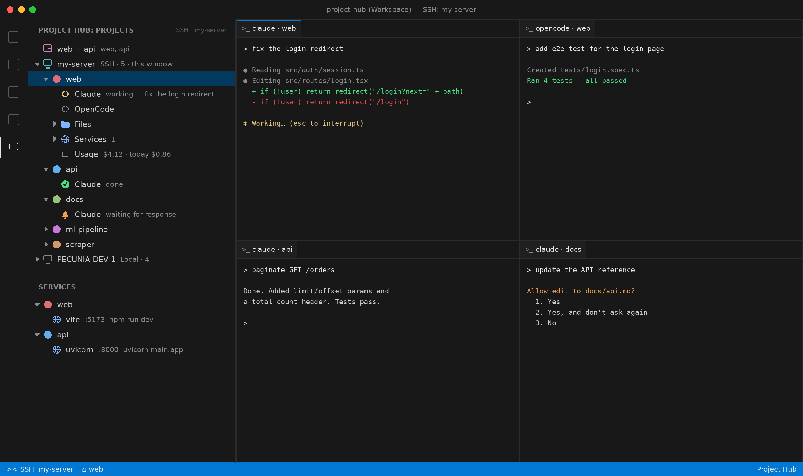
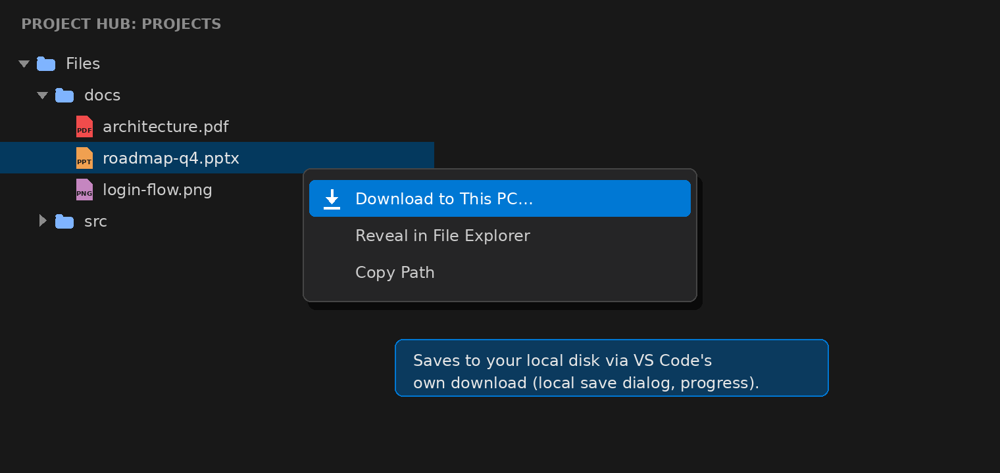
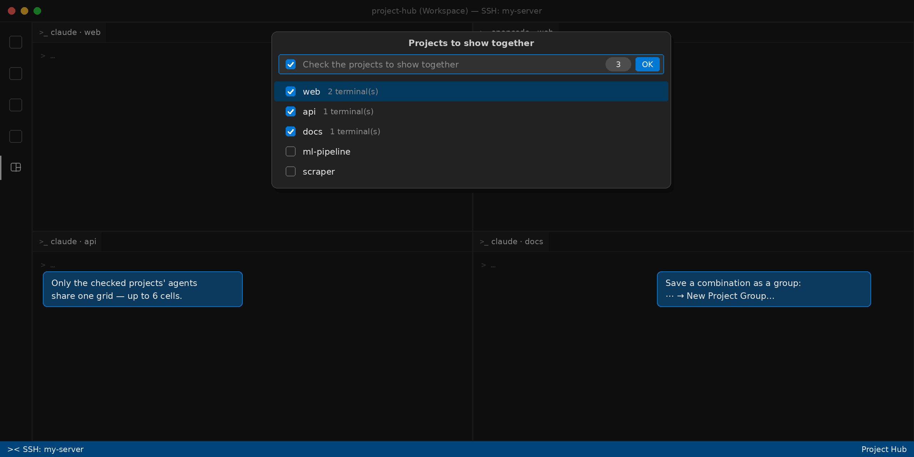
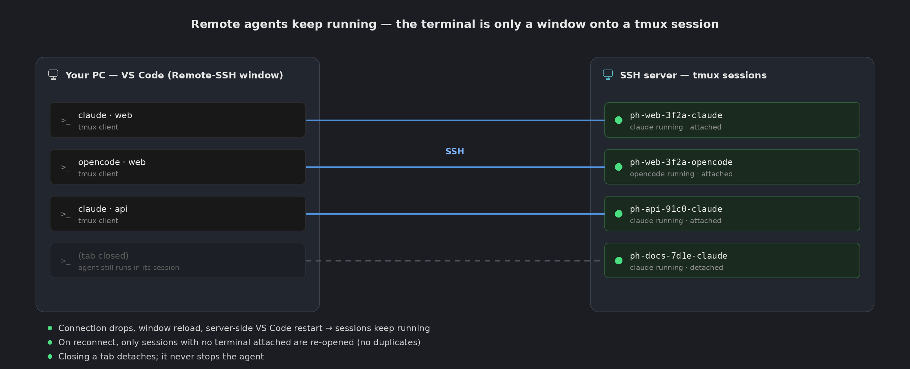

# Project Hub — Multi-Project & Agent Workspace

**1つの VS Code ウィンドウで、複数のプロジェクトと独立した AI エージェントセッションを。**

ウィンドウをリロードせずに、サイドバーの一覧からプロジェクトを切り替えられます。ターミナルや Claude / Codex / Gemini / Antigravity / OpenCode のセッションはバックグラウンドで動き続け、エージェントが作業を終えたり入力を待っていたりすると、ワンクリックの **プロジェクトに切り替え** ボタン付きの通知でお知らせします。他の PC や SSH サーバー上のプロジェクトも同じ一覧に表示されます。

[English](README.md) · [한국어](README.ko.md) · [简体中文](README.zh-CN.md) · **日本語**

*UI 言語: English · 한국어 · 日本語 · 简体中文 · 繁體中文 (VS Code の表示言語に従います)。*



## パッチノート

### 0.22.3
- **修正: 新しい SSH サーバーに別のサーバーのプロジェクトが表示されることがある問題。** PC に保存しているプロジェクト一覧のバックアップは、ホスト名をキーにしていました。そのため、サーバー名を変更した後で同じ旧名を付けた新しいサーバーでは旧サーバーの一覧が復元され、そのサーバーには存在しないフォルダーのプロジェクトが表示されていました。バックアップは接続アドレス (`user@IP`) をキーにするようになり、復元時はそのマシン上にフォルダーが存在するプロジェクトだけを残します。

### 0.22.2 — リモートからのダウンロード
- **このPCにダウンロード…** — リモート (SSH) ウィンドウで、ファイルツリーのファイルやフォルダーを右クリックすると、ローカルマシンに保存できます。PDF、スライド、画像など、ローカルのアプリで開きたいものに便利です。VS Code 標準のダウンロード機能 (ローカルの保存ダイアログ、進捗表示、フォルダー対応) を使います。



### 0.22.1
- **修正: リモートウィンドウでの「プロジェクトを追加」** — フォルダー選択がチェックボックスの一覧になり、フォルダーを開けなくなっていました。リモートウィンドウでは1回に1フォルダーずつ選択するようになりました。ローカルウィンドウでは引き続き複数を一度に選択できます。

### 0.22.0 — プロジェクトグループと選択したプロジェクトのグリッド
- **プロジェクトを選択…** — ⫽ グリッドボタンで、チェックしたプロジェクトのエージェントだけを1つのグリッドに並べて表示できます。
- **プロジェクトグループ** — 組み合わせを保存できます (**⋯ → 新しいプロジェクトグループ…**)。グループは一覧の先頭に表示され、ワンクリックでそのグリッドを開きます。
- **リモートのエージェントターミナルは tmux クライアントそのものに** — エージェントのプロンプトに誤って何かが入力されることはなくなり、VS Code 自身のターミナル復元で自動的に再アタッチされます。
- **修正:** リモートウィンドウをリロードしてもエージェントターミナルが二重になることはなくなりました。別のマシンのプロジェクトを繰り返しクリックしてもウィンドウが2つ開くことはなくなりました (SSH の確認中は *接続中…* の表示が出ます)。



### 0.21.0 – 0.21.2
- **Linux でのサービスとバックグラウンドプロセス** (SSH リモートを含む) — `/proc` から直接読み取り、サーバーは作業ディレクトリでプロジェクトに紐付け、tmux ペインも追跡し、停止は SIGTERM → SIGKILL で行います。
- **修正:** リモートの再起動後、実行中のエージェントのプロンプトに `tmux attach …` が入力されることがある問題。

### 0.20.0
- **自動起動するエージェントを選択** — 切り替え時に起動するエージェントを選ぶ (**既定のエージェントを選択**) か、毎回確認するか (`projectHub.autoStartAgent` = `ask`) を選べます。
- **修正:** リモートウィンドウで切り替えた後、グリッドの左側に空のペインが残る問題。

---

## Project Hub を選ぶ理由

エージェント向けに作られたターミナルマルチプレクサー (herdr など) や単体のエージェントデスクトップアプリ (Orca など) は、多数のエージェントを動かすのが得意です。Project Hub が担うのは一日のもう半分、**エージェントが触れるコード、エディター、サーバーを、VS Code を離れずに扱うこと** です。

- **エディターから離れない。** 2つ目のアプリも、2つ目のターミナルエミュレーターも不要です。エディター、デバッガー、Git ビュー、拡張機能、キーバインドはすべてそのままで、Project Hub が追加するのはサイドバーだけです。
- **推測ではなく正確なエージェントの状態。** Claude、Codex、Gemini、Antigravity は自身のフックを通じて *作業中 / 作業完了 / 応答待ち* を報告します。そのため状態はターミナル出力のパターン照合ではなく、エージェント自身が伝えたものです。**プロジェクトに切り替え** ボタン付きのトーストと、完了した作業のブリーフィングフィードも付いてきます。
- **プロジェクトごとの開発サーバー。** エージェントが起動したサーバーはすべて、ポートとともにそのプロジェクトの下に表示されます。開く、停止する、前回使ったコマンドで再起動する、が可能です。Windows と Linux (SSH リモートを含む) で動作します。
- **すべてのマシンを1つの一覧に。** PC 上のプロジェクトも各 SSH サーバー上のプロジェクトも1つのツリーに並びます。サーバーではエージェントが自動的に tmux 内で動作するため、接続が切れてもウィンドウをリロードしても終了しません。
- **Windows を本格サポート。** PowerShell、cmd、Git Bash に、通知、プロセスツリー、サービスまで一通り対応しています。
- **主導権はあなたに。** エージェント同士がメッセージを送り合ったり操作し合ったりすることはありません。人が入力し、エージェントの CLI がそれを実行します。グループやグリッドは複数のエージェントを同時に *見る* ためのもので、エージェント同士をつなぐためのものではありません。

| | Project Hub | エージェント向けターミナルマルチプレクサー<br>(例: herdr) | 単体のエージェントアプリ<br>(例: Orca) |
|---|---|---|---|
| 動作場所 | VS Code の中 | ターミナルの中 | 独立したデスクトップアプリ |
| 本格的なコードエディター、デバッガー、Git UI | ✅ VS Code そのもの | — | 基本的なもの |
| エージェントの状態 | エージェントのフック (正確) | 出力からの推定 | アクティビティ表示 |
| プロジェクトごとの開発サーバーとポート | ✅ 開く / 停止 / 再起動 | — | 内蔵ブラウザー |
| ローカル PC と SSH サーバーを1つの一覧に | ✅ | リモートモード | ✅ |
| リモートで切断されてもエージェントが存続 | ✅ tmux、自動 | ✅ 独自サーバー | 自動再接続 |
| Windows | ✅ | — | ✅ |
| プロジェクトごとのトークン使用量とコスト | ✅ | — | — |
| エージェントごとに1つの git worktree | — | — | ✅ |
| エージェントが他のエージェントに指示 | — (設計上) | 実験的 | ✅ |

<sub>2026年11月時点の比較で、各プロジェクトの公開ドキュメントに基づいています。「—」は提供されていない、またはドキュメントに記載がないことを示します。内容が古くなっている場合は issue を作成してください。</sub>

## この拡張機能が解決する問題

複数のリポジトリで複数の AI エージェントを動かすには、通常リポジトリごとに VS Code ウィンドウを1つずつ開くことになります。既存のウィンドウでフォルダーを開く (`openFolder`) とウィンドウがリロードされてすべてのターミナルが終了するため、エージェントのセッションも一緒に失われます。

Project Hub はウィンドウを **1つ** のまま保ちます。プロジェクトはハブワークスペースの中で入れ替わるため、エクスプローラーは切り替わっても、ターミナルとエージェントのセッションはすべて生き続けます。プロジェクト A でエージェントに作業させたままプロジェクト B で別の作業をし、A が終わればトーストで通知を受け取れます。

## 主な機能

**即時のプロジェクト切り替え** — ウィンドウのリロードも拡張機能ホストの再起動もありません。切り替わるのはエクスプローラーだけで、ターミナルはそのままです。

**独立したエージェントセッション** — プロジェクトごと・エージェントごとのターミナル。セッションは作業ディレクトリで区別されるため、プロジェクト同士が衝突することはありません。1つのプロジェクトで同じエージェントの複数セッションを動かすこともでき、それぞれ別の行として追跡されます。

**プロジェクトの作成・追加** — 既存のフォルダーを登録するか、新しいプロジェクトフォルダーを作成してそのまま切り替えます。

**切り替えずにファイルを閲覧** — 各プロジェクトには遅延読み込みのファイルツリーを持つ `ファイル` ノードがあり、ファイルアイコンテーマと Git ステータスの色が反映されます。作業中のプロジェクトを離れずに、別のプロジェクトの中身を確認できます。

**通知** — エージェントが作業を終えたとき、質問してきたとき、権限の承認を待っているときに、トーストとアクティビティバーのバッジでお知らせします。フックはユーザー全体に一度だけインストールされます。

**実行中のものを把握** — エージェントごとの状態行に入力したプロンプトを表示 (`Claude working… fix the login bug`)。**サービス** セクションにはエージェントが起動したすべての開発サーバーが一覧表示され (ワンクリックで停止可能)、プロジェクトごとにバックグラウンドプロセスのツリーもあります。

**ブリーフィングフィード** — 離席中に完了した作業を、各エージェントの最後の応答から要約したカード形式のフィードで表示します。再起動後も保持され、直近 200 件を残します。

**切り替えずに指示を送信** — プロジェクトを右クリックして入力すると、そのプロジェクトのエージェントターミナルに直接送られます。

**プロジェクトのターミナルグリッド** — 切り替えるたびに、アクティブなプロジェクトのエージェントターミナルだけを2列のエディターグリッドに表示します。他のプロジェクトのターミナルは閉じたパネルで実行を続けながら待機します。ワンクリックの *すべてのプロジェクト* 表示では、プロジェクトごとに1セルを使い、そのターミナルをタブとして並べます。

**使用量とコスト** — 保存済みセッションから集計した、プロジェクトごとの Claude トークン使用量と推定コスト。

**エディタータブの復元** — 各プロジェクトで開いていたタブを記憶し、切り替え時に復元します。

## 必要環境

| | |
|---|---|
| VS Code | 1.93.0 以降 |
| `curl` | 通知フックで使用します。Windows 10 以降、macOS、ほとんどの Linux ディストリビューションに標準で含まれています。 |
| エージェント CLI | 使用するもの — `claude`、`gemini`、`codex`、`agy`。`PATH` に含まれている必要があります。 |
| OS | クロスプラットフォーム。サービスとバックグラウンドプロセスのビューは Windows と Linux (SSH リモートを含む) に対応しています。macOS は未対応です。 |

## インストール

**VS Code Marketplace から (推奨)**

1. VS Code で拡張機能ビューを開きます (`Ctrl+Shift+X` / `Cmd+Shift+X`)。
2. **Project Hub** を検索して **Install** をクリックします。または直接開きます: [PecuniaEstAI.projecthub](https://marketplace.visualstudio.com/items?itemName=PecuniaEstAI.projecthub)。

**オフライン / 手動インストール (.vsix)**

```bash
code --install-extension projecthub-<version>.vsix
```

または: 拡張機能ビュー → 右上の `...` メニュー → **Install from VSIX…** → ファイルを選択します。

確認が表示されたらウィンドウをリロードします。アクティビティバーに **Project Hub** アイコンが表示されます。

**「Project Hub for Claude Code」(`pecuniaestai.claude-project-hub`) からのアップグレード**: 拡張機能 ID が `pecuniaestai.projecthub` に変わったため、VS Code は新しい拡張機能として扱います。新しい方をインストールしてから、古い方をアンインストールしてください。両方がインストールされている間は Project Hub が警告を表示します。プロジェクト一覧 (`~/.project-hub/`) とアバターは引き継がれ、ハブワークスペースは一度だけ移行を提案します。プロジェクトごとのエディタータブ、セッション名、PC/サーバー一覧は初期状態から始まります (一覧はウィンドウを開くにつれて再び埋まります)。

> アップグレード: Marketplace から更新する (拡張機能ビュー → **Installed** で絞り込み → **Update**) か、新しい `.vsix` を同じ手順でインストールします。VS Code が以前のバージョンをその場で置き換えます。プロジェクト一覧、色、ブリーフィング履歴は拡張機能の外 (`~/.project-hub/`) に保存されるため、アップグレードや再インストール後も残ります。

## はじめに

1. アクティビティバーの **Project Hub** アイコンをクリックします。
2. **プロジェクトを追加** (`+`) で既存のフォルダーを登録します。**新しいプロジェクトを作成** (新規フォルダーアイコン) は、フォルダーの作成と登録を一度に行い、そのプロジェクトに切り替えます。
3. プロジェクトをクリックすると切り替わります。最初のクリックでのみウィンドウがハブワークスペースとして一度開き直され、以降の切り替えは即座に行われます。
4. ターミナルボタン (▶ 既定のエージェント) またはロボットボタン (🤖 エージェントを選択) でエージェントを起動します。通知フックは初回起動時に自動でインストールされます。
5. エージェントが動いている間に別のプロジェクトで作業できます。作業が終わったり対応が必要になったりするとトーストが届くので、**プロジェクトに切り替え** をクリックすれば戻れます。

各プロジェクトの下の状態行: `🔄 作業中…` · `✅ 作業完了` · `🔔 応答待ち`。入力したプロンプトのテキストも並べて表示されます。

> **ワークスペースから `⌂ Hub` フォルダーを削除しないでください。** VS Code は *最初の* ワークスペースフォルダーが変わるとすべての拡張機能を再起動します。この小さな固定フォルダーが最初の枠を常に占有することで、プロジェクトは2番目の枠で入れ替わり、何も再起動されません — Claude Code 自体も含めてです。

## マルチエージェント

エージェントは `projectHub.agents` 設定で定義します。組み込みの既定値:

| エージェント | 新規セッション | 前回を再開 | 特定のセッションを再開 |
|---|---|---|---|
| Claude | `claude` | `claude --continue` | `claude --resume {sessionId}` |
| Gemini | `gemini` | `gemini --resume` | — |
| Codex | `codex` | `codex resume --last` | — |
| Antigravity | `agy` | `agy --continue` | `agy --conversation {sessionId}` |
| OpenCode | `opencode` | `opencode --continue` | `opencode --session {sessionId}` |
| Terminal | *(シェルのみ)* | — | — |

- 配列に追加すれば任意の CLI を使えます。既知の id は足りない項目が自動で補完されます。
- 開いているセッションがないプロジェクトに切り替えると `projectHub.defaultAgent` (既定は `claude`) が自動起動します。これは既定のターミナルボタンにも使われます。**Project Hub: 既定のエージェントを選択** を実行すると一覧から選べます。*毎回確認する* (`projectHub.autoStartAgent` = `ask`) を選ぶと、そうした切り替えのたびに選択画面が表示され、項目の 📌 ボタンでそのエージェントを既定にできます。自動起動は `projectHub.autoStartClaudeOnSwitch` でオフにできます。
- 通知は Claude、Codex、Gemini、Antigravity ですぐに使えます。OpenCode (プラグイン方式でフックなし) とプレーンな Terminal 項目には通知がありません。カスタムエージェントは `http://127.0.0.1:43917/hook/stop?agent=<id>` に `{"cwd": "..."}` を POST するように手動で設定できます。

## VS Code 再起動後のセッション

完全に再起動するとターミナルのプロセスは終了しますが、会話履歴は保持されています (例: `~/.claude/projects/<encoded path>`)。

- **⏱ 続きから開く** で前回の会話を復元します (`claude --continue`)。
- 右クリック → **Claudeセッションを選んで開く** で、保存済みセッションがプレビュー付きで一覧表示されます。それぞれ専用のターミナルで開く (`claude --resume <id>`) ため、複数のセッションを並行して動かせます。
- **自動再実行**: VS Code はエージェントターミナルをシェルだけの状態で復元します。起動から数秒後、Project Hub がそれぞれのターミナルでエージェントを再実行します — 既定のターミナルでは前回のセッションを、Claude セッションのターミナルではそのセッションを再開します。対象は今回の起動で新しく開始されたシェルだけです。ウィンドウのリロード後や、自分でエージェントを終了したターミナルには何も送信しません。Windows と Linux で動作します (macOS は未対応)。`projectHub.resumeAgentsOnRestart` でオフにできます。

## リモート (SSH)

Remote-SSH では拡張機能はリモートホスト上で動作するため、エージェントターミナル、プロジェクト一覧 (`~/.project-hub/`)、通知フックはすべてリモート側に置かれます。リモートウィンドウに拡張機能をインストールし (Marketplace から: 拡張機能ビュー → **Project Hub** を検索 → **Install in SSH: …**。リモートがネットワークに接続できない場合は VSIX から)、エージェント CLI をリモートの `PATH` に置いてください。

> **まず SSH キーを設定してください。** パスワードログインでは、Remote-SSH は **1回の接続でパスワードを何度も** 求め (ホストの確認、サーバーのインストール確認、接続そのもの)、新しいウィンドウ、リロード、再接続のたびにまた求めます。Project Hub は別のデバイスのプロジェクトをクリックするたびに新しいウィンドウを開くので、すぐに積み重なります。Remote-SSH はパスワードを保存できません。
>
> - **自動**: ローカルウィンドウで **Project Hub: サーバーに SSH キーを設定 (パスワード入力の繰り返しをなくす)** を実行します (または一覧のサーバーグループを右クリック)。キーがなければ `~/.ssh/id_ed25519` を作成し、サーバーのパスワードを **一度だけ** 入力するターミナルを開き、公開鍵をサーバーの `~/.ssh/authorized_keys` に追加して、キーログインが機能することを確認します。キーログインが設定されていないサーバーのプロジェクトをクリックすると、まずこの設定が提案されます。
> - **手動** (PowerShell): `ssh-keygen -t ed25519` を実行してから
>   `type $env:USERPROFILE\.ssh\id_ed25519.pub | ssh user@server "mkdir -p ~/.ssh && chmod 700 ~/.ssh && cat >> ~/.ssh/authorized_keys && chmod 600 ~/.ssh/authorized_keys"`
> - それでもキーログインに失敗する場合は、サーバーがキーログインを許可していない可能性があります。管理者に `/etc/ssh/sshd_config` の `PubkeyAuthentication yes` を確認してもらってください。

接続が切れても、リモートのターミナルが生き続けるのはしばらくの間だけです。リモートサーバーの再起動や更新があれば終了します。そのためリモートウィンドウでは、Project Hub が常にエージェントを自力で動かし続けようとします:

- **tmux がインストールされている場合**: 各エージェントは専用の tmux セッション (`ph-<project>-<hash>-<agent>`、マウススクロール有効) で動作し、エージェントターミナルは tmux クライアント *そのもの* です (`tmux new-session -A …`)。シェルに何も入力しないため、エージェントのプロンプトに何かが紛れ込むことはありません。再接続時、Project Hub は **ターミナルがアタッチされていない** セッションに対してだけターミナルを開き直すので、ウィンドウをリロードしてもターミナルが重複しません。
- **エージェントのタブを閉じてもデタッチされるだけです。** エージェントはセッション内で動き続け、次にウィンドウを開いたときに戻ってきます。本当に停止するには、エージェントとそのシェルを終了する (例: `/exit` の後に `exit`) か、`tmux kill-session -t '=ph-…'` を実行してください。
- **tmux がない場合**: これまでどおりエージェントは通常のターミナルで動作し、一度だけ通知が表示されます (*今後表示しない* を選択可能)。tmux は起動のたびに確認されるため、後からインストールすればすぐに有効になります。
- ローカルウィンドウには影響しません。サービスとバックグラウンドプロセスは Linux のリモートでも動作し、エージェントが tmux 内で起動したサーバーも対象です。
- VS Code を完全に再起動した後は、復元されたエージェントターミナルが2つ目のエージェントを起動する代わりに、それぞれの tmux セッションに再アタッチします (`projectHub.resumeAgentsOnRestart`)。



**PC とサーバーをまたいだ1つの一覧。** VS Code のウィンドウは1か所にしか接続できないため、PC とサーバーはそれぞれ自分のプロジェクト一覧を持ち、切り替えはその場所の中で行われます。また、各ウィンドウは自分の一覧を他のウィンドウと共有します:

- ビューのタイトルに、このウィンドウの接続先が表示されます。例: `ローカル · PECUNIA-DEV-1`、`SSH · my-server`。
- 他の PC やサーバーが認識されると、一覧は **デバイス → プロジェクト** の形になります。このウィンドウのデバイスが先頭に (展開され、*このウィンドウ* と表示されて) 並び、その他のデバイスが同じ階層に続きます (PC は `device-desktop` アイコン、SSH サーバーは `remote` アイコン)。デバイスが1つだけならプロジェクトが直接一覧表示されます。サーバーは、Project Hub をインストールした状態でそのサーバーのウィンドウを一度開くと表示されるようになります。
- 別のグループのプロジェクトをクリックすると、そこに接続したウィンドウが開き、そのプロジェクトに切り替わります。そのウィンドウが既に開いていれば、VS Code はそのウィンドウに移動します。常に別のウィンドウになります。
- グループを右クリック → **この PC/サーバーを一覧から隠す**。そこで次にウィンドウを開くと再び表示されます。
- SSH グループは `user@<server IP>` として再接続します。標準以外のポートやキーは、その IP に対して `~/.ssh/config` で設定してください。

## サービスとプロセス

- **サービス** セクションには、登録済みプロジェクトに属し、ポートをリッスンしているすべてのプロセスが一覧表示されます。プロジェクトごとにグループ化され、サービス単位とプロジェクト単位の停止ボタンに加え、使用したコマンドを記憶する **サービスを再起動** アクションもあります。デタッチして起動したサーバーや別のウィンドウから起動したサーバーも、コマンドラインとプロセスの親子関係から検出されます。
- Web サービスには `http://localhost:<port>` を開く **ブラウザーで開く** ボタンが付きます。PostgreSQL、MySQL、Redis、MongoDB、Node インスペクターなど、HTTP ではないことがわかっているポートやプロセスには付きません。ポート 443 と 8443 は https で開きます。サービスが複数の Web ポートをリッスンしている場合はどれを開くか確認され、ツールチップにはそれらがクリック可能なリンクとして一覧表示されます。
- 各プロジェクトには、エージェントターミナル配下のすべてを表示する **バックグラウンドプロセス** ノードもあります。MCP サーバーと内部ヘルパーは既定で非表示です (「MCP・ヘルパー N件を非表示」の行で切り替えます)。

## プロジェクトファイルの閲覧

各プロジェクトの行には **ファイル** ノードがあり、そのプロジェクトのファイルツリーをサイドバーで直接見られます。

- ディレクトリは **展開したときにだけ、1階層ずつ** 読み込まれるため、大きなリポジトリでも中を見るまでは負荷がかかりません。
- 各行は実際のファイル URI を持つため、エクスプローラーとまったく同じように **ファイルアイコンテーマ** と **Git ステータスの色** が反映されます。
- ファイルをクリックするとプレビュータブで開きます。`projectHub.switchOnRowClick` がオン (既定) の場合は、まずそのプロジェクトに切り替えます。オフにすると、エクスプローラーを動かさずに別のプロジェクトを覗けます。
- ファイルやフォルダーを右クリックすると **エクスプローラーで表示** と **パスをコピー** が使えます。
- リモート (SSH) ウィンドウでは、右クリック → **このPCにダウンロード…** でファイルやフォルダーをローカルマシンに保存できます。PDF、スライド、画像など、ローカルのアプリで開きたいものに使えます。VS Code 標準のエクスプローラーのダウンロード機能 (ローカルの保存ダイアログ、進捗表示、フォルダー対応) を使うため、サイドバーに一時的にエクスプローラーが表示されます。別のプロジェクトのファイルの場合は、まずそのプロジェクトに切り替えます。
- `projectHub.fileTreeExclude` で一覧に表示したくない名前を非表示にできます (既定は `.git`、`node_modules` など)。glob ではなく名前の完全一致で比較します。
- ツリーは展開時に読み込まれます。VS Code の外で作成したファイルを反映するには、**Project Hub: 最新の情報に更新** を使うか、折りたたんでから展開し直してください。

## ターミナルの配置

VS Code にはターミナルのタブ一覧をプロジェクトで絞り込む方法がないため、Project Hub はアクティブなプロジェクトのターミナルをエディター領域に移動することで、それだけを表示します。

- **プロジェクトグリッド** (`projectHub.projectTerminalGrid`、既定でオン): 切り替えるたびに、アクティブなプロジェクトのエージェントターミナルが2列のグリッドでエディター領域を埋めます (1セルに1ターミナル、最大 6)。他のプロジェクトのターミナルはセッションを保ったまま閉じたパネルに戻ります。アクティブなプロジェクトで別のエージェントを開くとグリッドが再構成されます。開いているファイルは最初のセルにバックグラウンドのタブとして残ります。
- **⫽ ボタン**: 必要なときに配置します。*すべてのプロジェクト* ではプロジェクトごとに1セルを使い、そのターミナルをタブとして並べます。*アクティブなプロジェクトのみ* ではターミナルごとに1セルを使います。プロジェクトグリッドがオンの場合、次の切り替えや新しいエージェントの起動でアクティブなプロジェクトのグリッドに戻ります。
- **プロジェクトを選択**: ⫽ ボタンには *プロジェクトを選択…* もあります。2つ以上のプロジェクトをチェックすると、それらのエージェントだけが1つのグリッドに並びます (エージェントが 6 つまでならエージェントごとに1セル、それを超えるとプロジェクトごとに1セルでエージェントをタブとして並べます)。エージェントが動いていないプロジェクトでは既定のエージェントが起動します (`projectHub.autoStartClaudeOnSwitch` がオフの場合を除く)。前回の選択は次回あらかじめチェックされます。このグリッドの表示中は、エージェントを開いてもアクティブなプロジェクトのグリッドには戻りませんが、プロジェクトを切り替えると戻ります。
- **プロジェクトグループ**: よく使う組み合わせを保存できます。**⋯ → 新しいプロジェクトグループ…** でプロジェクトと名前を選ぶと、グループが一覧の先頭に表示され、クリックするとそのグリッドが表示されます。編集 (✎) と削除 (🗑) は行にあります。グループはマシンごとに `~/.project-hub/projects.json` に保存されます。グループを削除しても、そのプロジェクトやエージェントには影響しません。
- **複数プロジェクトのグリッドの制約**:
  - 1つのウィンドウは1台のマシンにしか接続できないため、グリッドに入れられるのはそのマシンのプロジェクトだけです。ローカルと SSH サーバーのプロジェクトを同じグリッドに並べることはできません。
  - 最大 6 セルです。それを超えるターミナルは最後のセルにタブとして入ります。
  - これは **あなた** が複数のエージェントを見ながら入力するためのビューです。Project Hub はエージェント間でメッセージを中継しません。エージェント同士が会話することはなく、人がターミナルに入力したものをそのエージェントの CLI が実行します。
- プロジェクトグリッドがオフの場合: `projectHub.splitAgentTerminals` はプロジェクトの次のエージェントを既存のターミナルの横に分割して開き、`projectHub.terminalsInEditor` はエージェントターミナルをエディタータブとして開きます。
- VS Code はターミナルだけを含むエディターグループを自動でロックする (`workbench.editor.autoLockGroups`) ため、開いたファイルは別のグループに入ります。Project Hub は配置し直す前に、ロックを解除して空のグループを閉じます。
- 任意のターミナルを右クリック → **このターミナルをプロジェクトに関連付け** で、自分で開いたターミナルをプロジェクトに取り込めます。

## ブリーフィングと使用量

- **ブリーフィング**: 完了した作業と確認が必要な依頼を、エージェントの最後の応答を要約として表示する Web ビューのカードフィードです。*もっと見る* で展開し、プロジェクト名をクリックすると切り替わります。
- **使用量**: Claude のセッションがあるプロジェクトには使用量の行が表示されます。累計と今日の推定コストを示し、ツールチップにモデル別の内訳が表示されます。推定は定価に基づきます (キャッシュ書込 1.25×、キャッシュ読取 0.1×)。サブスクリプションプランの場合、これは API 換算の推定額であり、請求額ではありません。

## コマンド

コマンドパレット (`Ctrl+Shift+P`) から実行できます:

| コマンド | 内容 |
|---|---|
| Project Hub: プロジェクトを追加 | 既存のフォルダーを登録 (ローカルでは複数を一度に、リモートウィンドウでは1つずつ) |
| Project Hub: 新しいプロジェクトを作成 | フォルダーを作成・登録し、そのプロジェクトに切り替え |
| Project Hub: 現在のフォルダーをプロジェクトとして追加 | 現在開いているフォルダーを登録 |
| Project Hub: プロジェクトをクイック切り替え | あいまい検索でプロジェクトを選択 (ステータスバーからも可能) |
| Project Hub: エージェントターミナルをグリッド配置 | 2列のエディターグリッド (すべて / アクティブなプロジェクト / 選択したプロジェクト / グループ) |
| Project Hub: 新しいプロジェクトグループ… | 1つのグリッドにまとめて表示するプロジェクトを保存 |
| Project Hub: プロジェクトグループをグリッドで表示 | 保存したグループのエージェントを1つのグリッドに表示 |
| Project Hub: サーバーに SSH キーを設定 (パスワード入力の繰り返しをなくす) | パスワードを一度入力するだけで SSH キーを登録 (ローカルウィンドウ) |
| Project Hub: このターミナルをプロジェクトに関連付け | 自分で開いたターミナルをプロジェクトに取り込む |
| Project Hub: 完了通知の設定 (グローバルフックをインストール) | グローバルフックを (再) インストール |
| Project Hub: 最新の情報に更新 | プロセス、使用量、ツリーを再取得 |

プロジェクトの行を右クリックすると、プロジェクトごとの操作が使えます: 続きから開く、セッションを選ぶ、特定のエージェントで開く、指示を送る、識別カラーを設定する、一覧から削除する。

## 設定

| 設定 | 既定値 | 説明 |
|---|---|---|
| `projectHub.port` | `43917` | 通知用のローカル HTTP ポート (変更後はフックを再インストール) |
| `projectHub.agents` | Claude/Gemini/Codex/Antigravity/OpenCode/Terminal | エージェント一覧 (id, label, command, resumeCommand, resumeSessionCommand) |
| `projectHub.defaultAgent` | `claude` | 自動起動と既定のターミナルボタンに使うエージェント |
| `projectHub.focusClaudeTerminalOnSwitch` | `true` | 切り替え時にプロジェクトのターミナルを表示 |
| `projectHub.switchOnRowClick` | `true` | エージェント、使用量、サービスの行をクリックすると、まずそのプロジェクトに切り替え |
| `projectHub.autoStartClaudeOnSwitch` | `true` | プロジェクトにターミナルがなければ既定のエージェントを自動起動 |
| `projectHub.autoStartAgent` | `default` | 自動起動で開くもの: `default` = `projectHub.defaultAgent`、`ask` = 毎回エージェントを選択 |
| `projectHub.autoInstallHooks` | `true` | 通知フックを自動でインストール |
| `projectHub.restoreEditorsOnSwitch` | `true` | プロジェクトごとにエディタータブを保存・復元 |
| `projectHub.projectTerminalGrid` | `true` | アクティブなプロジェクトのエージェントターミナルだけをエディターグリッドに表示 |
| `projectHub.resumeAgentsOnRestart` | `true` | VS Code の完全な再起動後に復元されたターミナルでエージェントを再実行 |
| `projectHub.splitAgentTerminals` | `true` | プロジェクトの次のエージェントを既存のターミナルの横に分割して開く (プロジェクトグリッドがオフの場合のみ) |
| `projectHub.terminalsInEditor` | `false` | エージェントターミナルをエディタータブとして開く (プロジェクトグリッドがオフの場合のみ) |
| `projectHub.fileTreeExclude` | `.git`, `node_modules`, `.venv`, `__pycache__`, `dist`, `out`, `.next` | ファイルツリーで非表示にする名前 (glob ではなく完全一致) |
| `projectHub.showAllProcesses` | `false` | プロセス一覧に MCP サーバーとヘルパーも表示 |
| `projectHub.windowColor` | `false` | タイトルバーをプロジェクトの色で着色 |
| `projectHub.notifyForActiveProject` | `true` | アクティブなプロジェクトも通知 (フォーカスが外れているとき) |
| `projectHub.notificationTimeout` | `10` | トーストを N 秒後に自動で隠す (0 = 表示し続ける) |

## 仕組み

- **リロードなしの切り替え**: フォルダー全体を置き換える (`openFolder`) とウィンドウがリロードされ、すべてのターミナルが終了します。Project Hub は代わりに `updateWorkspaceFolders` でハブワークスペース (`.code-workspace`) 内のフォルダーを入れ替えるため、エクスプローラーが切り替わってもターミナルとエージェントのセッションは生き続けます。
- **アンカーフォルダー (`⌂ Hub`)**: VS Code は最初のワークスペースフォルダーが変わるとすべての拡張機能を再起動します。小さな固定フォルダーがその枠を常に占有し、プロジェクトは2番目の枠でのみ入れ替わります。
- **セッションの分離**: 各エージェントは、プロジェクトを作業ディレクトリとする専用のターミナルで動作します。CLI はセッションを cwd ごとに区別するため、プロジェクト同士がセッションを共有することはありません。
- **通知**: フックはユーザー全体の設定に一度だけインストールされます — Claude `~/.claude/settings.json`、Codex `~/.codex/hooks.json`、Gemini `~/.gemini/settings.json`、Antigravity `~/.gemini/antigravity-cli/hooks.json`。イベントごとにフックがローカルの HTTP サーバーに POST し、ペイロードの作業ディレクトリからプロジェクトを特定します。リポジトリには何も書き込みません。Windows ではコマンドが `curl.exe … -d '@-'` になります。これは Git Bash (Claude) でも PowerShell (Gemini は `powershell -Command` でフックを実行し、そこではプレーンな `curl` が `Invoke-WebRequest` のエイリアスになります) でも同じ意味になります。
- **データの保存場所**: プロジェクト一覧とプロジェクトグループ (`projects.json`)、ブリーフィング履歴、保存した再起動コマンドは、各マシンの `~/.project-hub/` にあります。トークン使用量はエージェント CLI 自身のセッションファイルから読み取るだけで、書き込むことはありません。

## トラブルシューティング

**通知が届かない。**
**Project Hub: 完了通知の設定 (グローバルフックをインストール)** を実行してフックを再インストールし、実行中のエージェントセッションを再起動してください。セッションはフックを起動時に読み込みます。`projectHub.port` を変更した場合は、それに合わせてフックを再インストールする必要があります。

**Windows で Gemini の通知がまったく来ない (0.18.4 より前)。**
Gemini は PowerShell 経由でフックを実行するため、以前の `curl … -d @-` コマンドはそこで失敗していました。0.18.4 では `curl.exe … -d '@-'` に変更され、次に Project Hub からエージェントを開いたとき (または **Project Hub: 完了通知の設定 (グローバルフックをインストール)** を実行したとき) に古いフックが再インストールされます。その後、実行中の Gemini セッションを再起動してください。

***応答待ち* / *作業完了* の行をクリックすると、同じセッションが2つ目のターミナルで開いた (0.18.4 より前)。**
プロジェクトへの切り替えによって、行がセッションの生存を確認する前に状態がクリアされ、`--resume` でもう一度再開されていました。修正済み: 切り替え前に生存を確認し、そのエージェントの既存のターミナルを表示するようになりました。それでも2つのターミナルが1つの会話を共有している場合は、片方を `/exit` で終了してください。

**「ポートは既に使用中」の警告。**
別のウィンドウまたはプログラムがポートを使用しています。ハブワークスペースのウィンドウが優先的にポートを所有し、他のウィンドウは自動的に引き渡すため、通常はもう一方の VS Code ウィンドウを閉じれば解決します。別のプログラムが使用している場合は、`projectHub.port` を変更してフックを再インストールしてください。

**切り替えるたびにすべての拡張機能が再起動する。**
`⌂ Hub` アンカーフォルダーがワークスペースから削除されています。プロジェクトを一度切り替えると、最初の枠に再作成されます。

**開発サーバーが動いているのに、プロジェクトのサービスセクションが空になっている。**
サービスの検出は Windows と Linux で動作します (macOS は未対応)。サーバーはコマンドラインとプロセスの親子関係で照合され、Linux では作業ディレクトリでも照合されます。そのため、プロジェクトフォルダー内で起動した `npm run dev` は、パスが一切現れなくてもプロジェクトに紐付けられます。Windows では、プロジェクトのパスにまったく触れない方法で起動したサーバーは紐付けられないことがあります。それでもエージェントターミナルから起動したものであれば **バックグラウンドプロセス** の下に表示されます。Linux では自分のユーザーのプロセスだけが見えます。

**プロジェクトの下の行をクリックしたのに、エクスプローラーには前のプロジェクトが表示されたままになっている。**
エージェント、使用量、サービスの行をクリックすると、既定ではそのプロジェクトに切り替わります。切り替わらない場合は `projectHub.switchOnRowClick` がオフになっています。この設定は、エクスプローラーを動かさずに別のプロジェクトのターミナルを見られるようにするためのものです。プロジェクトの行自体は常に切り替わります。

**Python プロジェクトでエージェントが勝手に終了し、ターミナルに `Activate.ps1` / `deactivate` の行が表示される。**
Python Environments 拡張機能は、ターミナルにコマンドを入力することで仮想環境をアクティブ化します。プロジェクトの切り替えでワークスペースフォルダーが変わると、エージェントが既に動いているターミナルに `deactivate` とアクティブ化コマンドを再入力するため、エージェントが終了します。ユーザー設定で、ターミナルへの入力をやめさせてください:

```json
"python-envs.terminal.autoActivationType": "off"
```

`shellStartup` でもコマンドの入力は避けられますが、PowerShell プロファイルを編集します。エージェントは通常、プロジェクトの `.venv` を自分で見つけます。

**エージェントコマンドの最初の1文字が欠ける (`laude --continue`)。**
0.15.4 で修正済み: シェルが準備完了を通知した時点 (シェル統合) で、またはシェル統合のないシェルでは 4 秒後にコマンドを送信します。

**フックがエージェントをブロックしているように見える。**
ブロックすることはありません。フックは 3 秒のタイムアウト付きで `curl` を使い、サーバーが停止していても何も表示せずに失敗します。

## 制限事項

- サービスとバックグラウンドプロセスは Windows (PowerShell) と Linux (`/proc`) に対応しています。macOS はまだ未対応です。それ以外はすべてクロスプラットフォームです。
- エージェント間の通信はありません。各エージェントは、人がそのターミナルに入力したものを実行する独立した CLI です。複数プロジェクトのグリッドは、それらを並べて表示するだけです。
- グリッドに入れられるのは、ウィンドウの接続先マシンのプロジェクトだけです (ローカルと SSH のプロジェクトは混在できません)。
- Codex の `resume --last` の cwd による絞り込みには 2026 年以降の CLI が必要です。
- Antigravity のフックイベントは現在の公開ドキュメントに従っています。通知が来ない場合はお知らせください。
- 使用量の数値は定価に基づく推定であり、請求データではありません。

## ライセンス

MIT
