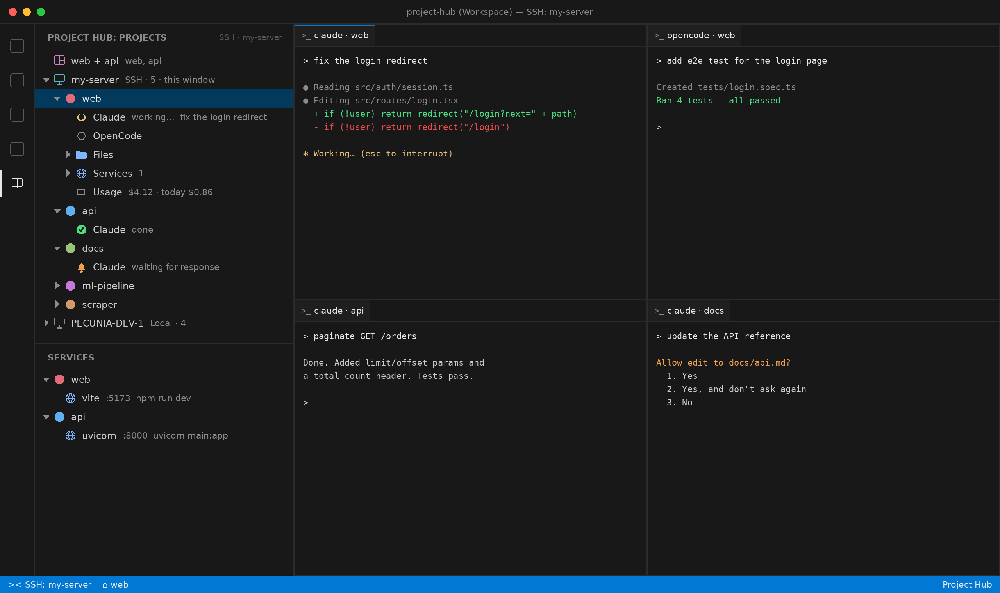
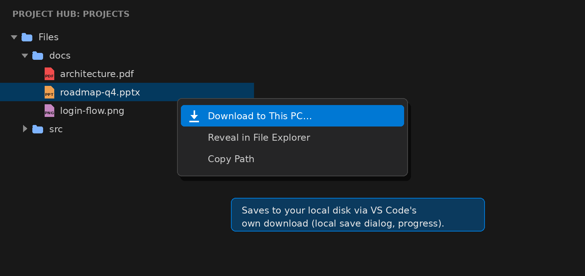
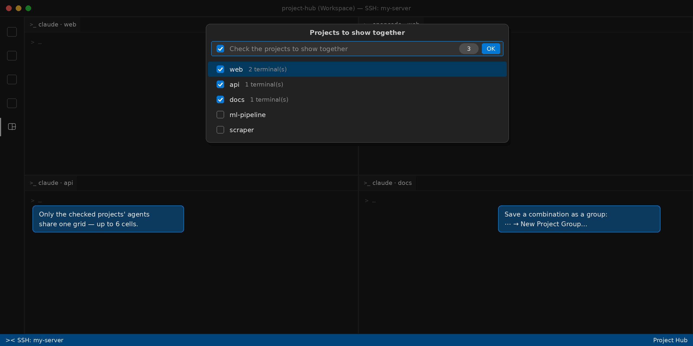
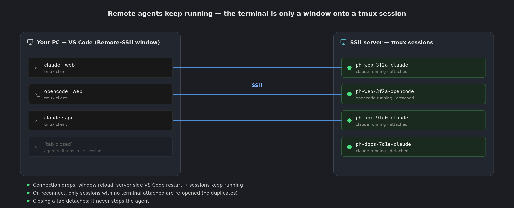

# Project Hub — Multi-Project & Agent Workspace

[English](README.md) · **한국어** · [简体中文](README.zh-CN.md) · [日本語](README.ja.md)

**여러 프로젝트와 에이전트를 VS Code 창 하나에서.**

사이드바에서 창 리로드 없이 프로젝트를 전환하고, Claude / Codex / Gemini / Antigravity / OpenCode 세션을 프로젝트별로 격리해 실행합니다. 백그라운드 작업이 끝나면 알림이 오고, **프로젝트로 전환** 버튼 한 번으로 돌아갑니다. 다른 PC와 SSH 서버의 프로젝트도 같은 목록에 보입니다.

*UI 언어: English · 한국어 · 日本語 · 简体中文 · 繁體中文 (VS Code 표시 언어를 따릅니다).*



## 패치 노트

### 0.22.3
- **수정: 새 SSH 서버에 다른 서버의 프로젝트가 보이던 문제.** PC에 보관하는 프로젝트 목록 백업을 서버 이름으로 구분해서, 서버 이름을 바꾼 뒤 그 이름을 받은 새 서버가 옛 서버의 목록을 복구해 가고 그 서버에 없는 폴더의 프로젝트가 보였습니다. 이제 백업은 접속 주소(`user@IP`)로 구분하고, 복구할 때는 그 장비에 폴더가 실제로 있는 프로젝트만 가져옵니다.

### 0.22.2 — 원격 파일 다운로드
- **이 PC로 다운로드…** — 원격(SSH) 창의 파일 트리에서 파일·폴더를 우클릭해 내 PC에 저장합니다. PDF, pptx, 이미지처럼 PC의 프로그램으로 열고 싶은 파일에 씁니다. VS Code 자체 다운로드 기능(PC 쪽 저장 창, 진행률, 폴더)을 그대로 씁니다.



### 0.22.1
- **수정: 원격 창의 프로젝트 추가** — 폴더 선택 창이 체크박스 목록으로 바뀌어 폴더 안으로 들어갈 수 없었습니다. 원격 창에서는 한 번에 한 폴더씩 고르고, 로컬 창은 여전히 여러 개를 한 번에 고릅니다.

### 0.22.0 — 프로젝트 그룹·선택 그리드
- **프로젝트 고르기…** — ⫽ 그리드 버튼에서 체크한 프로젝트들의 에이전트만 한 그리드에 나란히 띄웁니다.
- **프로젝트 그룹** — 자주 쓰는 조합을 저장합니다(**⋯ → 새 프로젝트 그룹…**). 목록 맨 위에 생기고, 누르면 그 그리드를 바로 띄웁니다.
- **원격 에이전트 터미널 = tmux 클라이언트** — 셸에 명령을 타이핑하지 않으므로 에이전트 입력창에 명령이 잘못 들어갈 일이 없고, VS Code 자체 터미널 복원이 알아서 다시 붙습니다.
- **수정:** 원격 창을 리로드하면 에이전트 터미널이 두 배로 늘던 문제, 다른 장비의 프로젝트를 연달아 누르면 창이 두 개 뜨던 문제(SSH 확인 중 *연결하는 중…* 표시).



### 0.21.0 – 0.21.2
- **Linux 서비스·백그라운드 프로세스** (SSH 원격 포함) — `/proc` 직접 조회, 작업 디렉터리 기준 귀속, tmux 창 추적, SIGTERM → SIGKILL 종료.
- **수정:** 원격 재시작 후 `tmux attach …`가 실행 중인 에이전트 입력창에 입력되던 문제.

### 0.20.0
- **자동 시작 에이전트 선택** — 전환할 때 띄울 에이전트를 고르거나(**기본 에이전트 선택**) 매번 묻게 할 수 있습니다(`projectHub.autoStartAgent` = `ask`).
- **수정:** 원격 창에서 전환 후 그리드 왼쪽에 빈 칸이 생기던 문제.

---

## 왜 Project Hub인가

에이전트용 터미널 멀티플렉서(예: herdr)나 별도 에이전트 데스크톱 앱(예: Orca)은 에이전트를 여러 개 돌리는 데 강합니다. Project Hub는 그 나머지, 즉 **에이전트가 손대는 코드·편집기·서버를 VS Code를 떠나지 않고 다루는 일**에 맞춰져 있습니다.

- **편집기를 떠나지 않습니다.** 별도 앱도, 별도 터미널 프로그램도 필요 없습니다. 편집기, 디버거, Git 화면, 확장, 단축키가 그대로이고 Project Hub는 사이드바 하나만 더합니다.
- **추측이 아닌 정확한 상태.** Claude, Codex, Gemini, Antigravity가 자체 hook으로 *작업 중 / 완료 / 응답 대기*를 직접 알려 줍니다. 터미널 출력을 보고 짐작하는 방식이 아닙니다. **프로젝트로 전환** 버튼이 달린 알림과 끝난 작업을 모아 보는 브리핑도 함께 옵니다.
- **프로젝트별 개발 서버.** 에이전트가 띄운 서버가 포트와 함께 그 프로젝트 아래에 보입니다. 열기, 중지, 마지막에 쓴 명령으로 재시작까지 됩니다. Windows와 Linux(SSH 원격 포함)에서 동작합니다.
- **모든 장비를 한 목록에.** PC와 각 SSH 서버의 프로젝트가 한 트리에 있습니다. 서버에서는 에이전트가 자동으로 tmux 안에서 실행되어, 연결이 끊기거나 창을 리로드해도 죽지 않습니다.
- **Windows를 제대로 지원.** PowerShell, cmd, Git Bash 모두 알림·프로세스 트리·서비스까지 끝까지 지원합니다.
- **통제권은 사람에게.** 에이전트끼리 메시지를 주고받거나 서로를 조종하지 않습니다. 사람이 입력하면 그 에이전트의 CLI가 실행합니다. 그룹과 그리드는 여러 에이전트를 한눈에 *보기* 위한 것이지, 서로 연결하기 위한 것이 아닙니다.

| | Project Hub | 에이전트 터미널 멀티플렉서<br>(예: herdr) | 별도 에이전트 앱<br>(예: Orca) |
|---|---|---|---|
| 실행 위치 | VS Code 안 | 터미널 안 | 별도 데스크톱 앱 |
| 완전한 편집기·디버거·Git 화면 | ✅ VS Code 그대로 | — | 기본 수준 |
| 에이전트 상태 | 에이전트 hook (정확) | 출력 패턴 추정 | 활동 표시 |
| 프로젝트별 개발 서버·포트 | ✅ 열기 / 중지 / 재시작 | — | 내장 브라우저 |
| 로컬 PC + SSH 서버를 한 목록에 | ✅ | 원격 모드 | ✅ |
| 원격에서 연결이 끊겨도 에이전트 유지 | ✅ tmux 자동 | ✅ 자체 서버 | 자동 재연결 |
| Windows | ✅ | — | ✅ |
| 프로젝트별 토큰 사용량·비용 | ✅ | — | — |
| 에이전트마다 git worktree | — | — | ✅ |
| 에이전트가 다른 에이전트를 지휘 | — (의도된 설계) | 실험적 | ✅ |

<sub>2026년 11월 기준, 각 프로젝트의 공개 문서를 바탕으로 비교했습니다. "—"는 제공하지 않거나 문서에 언급이 없다는 뜻입니다. 바뀐 내용이 있으면 이슈로 알려 주세요.</sub>

## 이 확장이 해결하는 문제

여러 저장소에서 AI 에이전트를 동시에 돌리려면 보통 창을 저장소 수만큼 띄웁니다. 기존 창에서 폴더를 열면(`openFolder`) 창이 리로드되면서 터미널이 전부 죽고, 에이전트 세션도 같이 사라집니다.

Project Hub는 창을 **하나만** 씁니다. 허브 워크스페이스 안에서 폴더만 교체하므로 Explorer는 바뀌지만 터미널과 에이전트 세션은 그대로 살아 있습니다. A 프로젝트에 일을 시켜두고 B로 넘어가 작업하다가, A가 끝나면 알림을 받습니다.

## 주요 기능

- **즉시 전환** — 창 리로드도, extension host 재시작도 없습니다.
- **세션 격리** — 프로젝트×에이전트별 전용 터미널. 세션은 작업 디렉터리로 구분되어 섞이지 않고, 같은 에이전트를 한 프로젝트에서 여러 개 띄우면 세션별 행으로 나뉩니다.
- **프로젝트 추가·생성** — 기존 폴더를 등록하거나, **새 프로젝트 만들기**로 폴더를 새로 만들어 곧바로 전환합니다.
- **전환 없이 파일 훑어보기** — 프로젝트마다 **파일** 노드가 있어 Explorer처럼 파일 트리를 볼 수 있습니다. 파일 아이콘 테마와 Git 상태 색상이 그대로 적용되고, 작업 중인 프로젝트를 떠나지 않고 다른 프로젝트 안을 들여다볼 수 있습니다.
- **알림** — 완료·질문·권한 대기 시 토스트와 액티비티 바 배지. hook은 전역에 한 번만 설치됩니다.
- **무엇이 돌고 있는지** — 시킨 프롬프트가 함께 보이는 에이전트 상태 행(`Claude 작업 중… 로그인 버그 수정`), 에이전트가 띄운 dev 서버를 모아 보여주는 **서비스** 섹션(원클릭 종료·재시작), 프로젝트별 백그라운드 프로세스 트리.
- **브리핑** — 자리 비운 사이 끝난 작업을 카드 피드로. 에이전트의 마지막 응답이 요약으로 들어가며 최근 200개가 보존됩니다.
- **전환 없이 지시 보내기** — 프로젝트를 우클릭하고 입력하면 그 프로젝트의 에이전트 터미널로 바로 전달됩니다.
- **프로젝트 터미널 그리드** — 전환할 때마다 활성 프로젝트의 에이전트 터미널만 에디터 2열 그리드로 보여 줍니다. 다른 프로젝트 터미널은 닫힌 패널에서 계속 실행됩니다. *전체 프로젝트* 보기는 프로젝트마다 한 칸, 그 안의 터미널은 탭으로 합쳐 보여 줍니다.
- **사용량·비용** — 저장된 세션을 집계한 프로젝트별 Claude 토큰 사용량과 예상 비용.
- **에디터 탭 복원** — 프로젝트마다 열어둔 탭을 기억했다가 전환 시 되살립니다.

## 요구 사항

| | |
|---|---|
| VS Code | 1.93.0 이상 |
| `curl` | 알림 hook이 사용. Windows 10+, macOS, 대부분의 Linux에 기본 포함 |
| 에이전트 CLI | 사용하는 것만 — `claude`, `gemini`, `codex`, `agy`. `PATH`에 있어야 합니다 |
| OS | 크로스 플랫폼. **서비스·백그라운드 프로세스**는 Windows·Linux(SSH 원격 포함) 지원, macOS는 아직 미지원 |

## 설치

**VS Code 마켓플레이스에서 (권장)**

1. VS Code에서 확장 뷰를 엽니다 (`Ctrl+Shift+X` / `Cmd+Shift+X`).
2. **Project Hub**를 검색해서 **설치**를 누르거나, 바로가기: [PecuniaEstAI.projecthub](https://marketplace.visualstudio.com/items?itemName=PecuniaEstAI.projecthub)

**오프라인/수동 설치 (.vsix)**

```bash
code --install-extension projecthub-<version>.vsix
```

또는: 확장 뷰 → 우측 상단 `...` → **VSIX에서 설치…** → 파일 선택

안내가 뜨면 창을 다시 로드하세요. 액티비티 바에 **Project Hub** 아이콘이 생깁니다.

**"Project Hub for Claude Code"(`pecuniaestai.claude-project-hub`)에서 업그레이드할 때**: 확장 ID가 `pecuniaestai.projecthub`로 바뀌어 VS Code는 새 확장으로 취급합니다. 새 버전을 설치한 뒤 이전 확장을 제거하세요. 둘 다 설치되어 있으면 Project Hub가 경고합니다. 프로젝트 목록(`~/.project-hub/`)과 아바타는 그대로 이어지고, 허브 워크스페이스는 한 번 이전 안내가 뜹니다. 프로젝트별 편집기 탭, 세션 이름, PC·서버 목록은 새로 시작합니다(PC·서버 목록은 창을 열 때마다 다시 채워집니다).

> 업그레이드는 마켓플레이스에서(확장 뷰 → **설치됨** 필터 → **업데이트**) 하거나, 새 `.vsix`를 같은 방법으로 설치하면 이전 버전을 대체합니다. 프로젝트 목록·색상·브리핑 기록은 확장 바깥(`~/.project-hub/`)에 있어서 업그레이드나 재설치 후에도 유지됩니다.

## 시작하기

1. 액티비티 바의 **Project Hub** 아이콘을 클릭합니다.
2. **프로젝트 추가**(`+`)로 기존 폴더를 등록하거나, **새 프로젝트 만들기**(새 폴더 아이콘)로 폴더를 새로 만들어 등록하고 바로 전환합니다.
3. 프로젝트를 클릭해 전환합니다. 최초 1회만 허브 워크스페이스로 창이 다시 열리고, 이후 전환은 즉시입니다.
4. ▶ 버튼(기본 에이전트) 또는 🤖 버튼(에이전트 선택)으로 전용 터미널을 시작합니다. 알림 hook은 첫 실행 때 자동 설치됩니다.
5. 다른 프로젝트에서 일하는 동안 완료·응답 대기 알림이 오면 **프로젝트로 전환**으로 돌아갑니다.

상태 행: `🔄 작업 중…` · `✅ 작업 완료` · `🔔 응답 대기 중` — 옆에 **시킨 작업 내용**이 함께 표시됩니다.

> **`⌂ Hub` 앵커 폴더를 워크스페이스에서 제거하지 마세요.** VS Code는 워크스페이스의 *첫* 폴더가 바뀌면 모든 확장을 재시작합니다. 이 작은 고정 폴더가 첫 자리를 영구히 차지하고 있어야 프로젝트가 두 번째 자리에서만 교체되고, Claude Code를 포함한 어떤 확장도 재시작되지 않습니다.

## 멀티 에이전트

`projectHub.agents` 설정으로 관리합니다.

| 에이전트 | 새 세션 | 마지막 세션 | 특정 세션 |
|---|---|---|---|
| Claude | `claude` | `claude --continue` | `claude --resume {sessionId}` |
| Gemini | `gemini` | `gemini --resume` | — |
| Codex | `codex` | `codex resume --last` | — |
| Antigravity | `agy` | `agy --continue` | `agy --conversation {sessionId}` |
| OpenCode | `opencode` | `opencode --continue` | `opencode --session {sessionId}` |
| Terminal | *(셸만 열기)* | — | — |

배열에 항목을 추가하면 어떤 CLI든 등록할 수 있고, 알려진 id는 빠진 필드가 자동으로 채워집니다.

세션이 없는 프로젝트로 전환하면 기본적으로 `projectHub.defaultAgent`(기본값 `claude`)를 자동으로 띄웁니다. **Project Hub: 기본 에이전트 선택** 명령으로 목록에서 바꿀 수 있고, *매번 묻기*를 고르면(`projectHub.autoStartAgent`를 `ask`로) 전환할 때마다 띄울 에이전트를 선택합니다. 선택 창에서 항목 옆 📌를 누르면 그 에이전트가 기본값이 됩니다. 자동 시작 자체는 `projectHub.autoStartClaudeOnSwitch`로 끕니다.

Claude·Gemini·Codex·Antigravity는 알림을 지원하고, OpenCode(hook이 아닌 플러그인 방식)와 Terminal 항목은 알림이 없습니다. 직접 추가한 에이전트는 완료 시 `http://127.0.0.1:43917/hook/stop?agent=<id>`로 `{"cwd": "..."}`를 POST하도록 연결하면 됩니다.

## 재시작 후 세션 복구

창을 완전히 껐다 켜면 터미널 프로세스는 죽지만 대화 기록은 남아 있습니다(`~/.claude/projects/<경로 인코딩>`).

- **⏱ 이어서 열기**로 마지막 대화를 복원합니다(`claude --continue`).
- 우클릭 → **Claude 세션 골라서 열기**로 저장된 세션을 미리보기와 함께 고르면, 각각 별도 터미널에서 병행 복원됩니다.
- **자동 재실행**: VS Code는 에이전트 터미널을 셸만 남은 채 복원합니다. 시작 몇 초 뒤 Project Hub가 각 터미널에서 에이전트를 다시 실행합니다 — 기본 터미널은 마지막 세션, Claude 세션 터미널은 그 세션. 이번 실행에서 새로 뜬 셸만 대상이며, 창 리로드 후나 직접 에이전트를 종료해 둔 터미널에는 아무것도 보내지 않습니다. Windows·Linux에서 동작합니다 (macOS는 아직 미지원). `projectHub.resumeAgentsOnRestart`로 끌 수 있습니다.

## 원격 (SSH)

Remote-SSH에서는 확장이 원격 서버에서 실행되므로 에이전트 터미널, 프로젝트 목록(`~/.project-hub/`), 알림 hook이 모두 원격에 있습니다. 원격 창에 확장을 설치하세요 — 마켓플레이스에서(확장 뷰 → **Project Hub** 검색 → **SSH: …에 설치**) 하거나, 원격이 네트워크에서 격리돼 있으면 VSIX로 — 그리고 에이전트 CLI를 원격 `PATH`에 두세요.

> **SSH 키를 먼저 설정하세요.** 비밀번호 로그인이면 Remote-SSH는 **연결 한 번에 비밀번호를 여러 번**(서버 확인, 원격 서버 설치 확인, 실제 연결) 묻고, 새 창·새로고침·재연결 때마다 다시 묻습니다. Project Hub는 다른 장비의 프로젝트를 누르면 새 창을 열기 때문에 횟수가 금방 늘어납니다. Remote-SSH는 비밀번호를 저장하지 못합니다.
>
> - **자동**: 로컬 창에서 **Project Hub: 서버에 SSH 키 설정**을 실행하세요(목록의 서버 그룹 우클릭으로도 가능). 키(`~/.ssh/id_ed25519`)가 없으면 만들고, 터미널에서 서버 비밀번호를 **한 번만** 입력받아 서버의 `~/.ssh/authorized_keys`에 공개키를 등록한 뒤, 키 로그인이 되는지 확인합니다. 키 로그인이 안 되는 서버의 프로젝트를 누르면 이 설정을 먼저 권합니다.
> - **수동** (PowerShell): `ssh-keygen -t ed25519` 후
>   `type $env:USERPROFILE\.ssh\id_ed25519.pub | ssh user@서버 "mkdir -p ~/.ssh && chmod 700 ~/.ssh && cat >> ~/.ssh/authorized_keys && chmod 600 ~/.ssh/authorized_keys"`
> - 그래도 키 로그인이 안 되면 서버가 막아 둔 것일 수 있습니다. 관리자에게 `/etc/ssh/sshd_config`의 `PubkeyAuthentication yes`를 확인해 달라고 하세요.

연결이 끊겨도 원격 터미널은 한동안만 유지되고, 원격 서버가 재시작·업데이트되면 종료됩니다. 그래서 원격 창에서는 Project Hub가 항상 에이전트를 계속 돌리도록 처리합니다.

- **tmux 있음**: 에이전트마다 tmux 세션(`ph-<프로젝트>-<해시>-<에이전트>`, 마우스 스크롤 켜짐)에서 실행되고, 에이전트 터미널은 그 세션의 tmux 클라이언트(`tmux new-session -A …`) 자체입니다. 셸에 명령을 타이핑하지 않으므로 에이전트 입력창에 명령이 잘못 들어갈 일이 없습니다. 다시 연결하면 **붙어 있는 터미널이 없는** 세션만 터미널을 열어 붙으므로, 창을 리로드해도 터미널이 두 배로 늘지 않습니다.
- **에이전트 탭을 닫으면 분리(detach)만 됩니다.** 에이전트는 세션에서 계속 실행되고, 다음에 창을 열면 다시 붙습니다. 정말 끝내려면 에이전트와 셸을 종료하거나(예: `/exit` 후 `exit`), `tmux kill-session -t '=ph-…'`를 실행하세요.
- **tmux 없음**: 전처럼 일반 터미널로 실행하고 안내를 한 번 띄웁니다(*다시 표시 안 함* 가능). 실행할 때마다 tmux를 확인하므로 나중에 설치하면 바로 적용됩니다.
- 로컬 창에는 영향이 없습니다. 서비스·백그라운드 프로세스는 Linux 원격에서도 동작하며, 에이전트가 tmux 안에서 띄운 서버도 잡힙니다.
- VS Code를 완전히 재시작하면 복원된 에이전트 터미널이 에이전트를 새로 띄우지 않고 기존 tmux 세션에 다시 붙습니다 (`projectHub.resumeAgentsOnRestart`).



**여러 PC·서버를 한 목록에서.** VS Code 창 하나는 한 곳에만 연결되므로, PC·서버마다 프로젝트 목록이 따로 있고 전환도 그 안에서만 됩니다. 대신 모든 창이 자기 목록을 서로 공유합니다.

- 목록 제목 옆에 이 창이 연결된 곳이 표시됩니다(예: `로컬 · PECUNIA-DEV-1`, `SSH · my-server`).
- 다른 PC·서버가 하나라도 있으면 목록이 **장비 → 프로젝트** 구조가 됩니다. 이 창의 장비가 맨 위(펼침, *현재 창* 표시)에, 다른 장비는 같은 계층에 이어집니다(PC는 모니터 아이콘, SSH 서버는 원격 아이콘). 장비가 하나뿐이면 프로젝트가 바로 나옵니다. 서버는 Project Hub가 설치된 창으로 한 번 접속하면 나타납니다.
- 다른 그룹의 프로젝트를 누르면 그곳에 연결된 창을 열고 그 프로젝트로 전환합니다. 그 창이 이미 열려 있으면 새 창 대신 그 창으로 이동합니다. 항상 별도 창입니다.
- 그룹을 우클릭 → **이 PC/서버를 목록에서 숨기기**. 그곳에서 창을 다시 열면 다시 나타납니다.
- SSH 그룹은 `사용자@서버IP`로 다시 접속합니다. 22가 아닌 포트나 키는 `~/.ssh/config`에 그 IP 항목으로 설정하세요.

## 서비스·프로세스

- **서비스** 섹션은 등록된 프로젝트 소속으로 포트를 리슨 중인 프로세스를 프로젝트별로 묶어 보여주고, 개별·일괄 종료와 **서비스 재시작**(사용한 명령을 기억)을 제공합니다. 분리 실행했거나 다른 창에서 띄운 서버도 명령줄·조상 추적으로 잡습니다.
- 웹 서비스에는 **브라우저에서 열기** 버튼이 붙어 `http://localhost:<포트>`를 엽니다. PostgreSQL·MySQL·Redis·MongoDB·Node 인스펙터처럼 웹이 아닌 포트·프로세스에는 붙지 않고, 443·8443은 https로 엽니다. 웹 포트를 여러 개 리슨 중이면 어느 것을 열지 고르게 하며, 툴팁에도 클릭 가능한 링크로 나열됩니다.
- 프로젝트마다 **백그라운드 프로세스** 노드에서 에이전트 터미널 하위 프로세스를 확인할 수 있습니다. MCP·헬퍼는 기본 숨김이고 "N개 숨겨짐" 행으로 토글합니다.

## 프로젝트 파일 보기

프로젝트 행마다 **파일** 노드가 있고, 그 아래에 해당 프로젝트의 파일 트리가 펼쳐집니다.

- 디렉터리는 **펼칠 때 한 단계씩만** 읽습니다. 저장소가 아무리 커도 열어보기 전까지는 비용이 들지 않습니다.
- 각 행에 실제 파일 URI가 붙어 있어 **파일 아이콘 테마**와 **Git 상태 색상**이 Explorer와 똑같이 적용됩니다.
- 파일을 클릭하면 미리보기 탭으로 열립니다. `projectHub.switchOnRowClick`이 켜져 있으면(기본) 그 프로젝트로 전환한 뒤 열고, 끄면 Explorer를 그대로 둔 채 파일만 엽니다.
- 파일·폴더 우클릭 → **탐색기에서 보기**, **경로 복사**
- 원격(SSH) 창에서는 우클릭 → **이 PC로 다운로드…**로 파일·폴더를 내 PC에 저장합니다. PDF, pptx, 이미지처럼 PC의 프로그램으로 열고 싶은 파일에 씁니다. VS Code 탐색기의 다운로드 기능(PC 쪽 저장 창, 진행률, 폴더 지원)을 그대로 쓰기 때문에 사이드바가 잠깐 탐색기로 바뀌며, 다른 프로젝트의 파일이면 먼저 그 프로젝트로 전환합니다.
- `projectHub.fileTreeExclude`로 보이지 않게 할 이름을 지정합니다 (기본: `.git`, `node_modules` 등). glob이 아니라 이름 그대로 비교합니다.
- 트리는 펼칠 때 읽으므로, VS Code 밖에서 만든 파일은 **Project Hub: 새로 고침**을 누르거나 접었다 펴면 반영됩니다.

## 터미널 배치

VS Code는 터미널 탭 목록을 프로젝트별로 거르는 기능을 제공하지 않으므로, Project Hub는 활성 프로젝트 터미널을 에디터 영역으로 옮겨서 그것만 보이게 합니다.

- **프로젝트 그리드** (`projectHub.projectTerminalGrid`, 기본 켜짐): 전환할 때마다 활성 프로젝트의 에이전트 터미널이 에디터 영역을 2열 그리드로 채웁니다(터미널마다 한 칸, 최대 6칸). 다른 프로젝트 터미널은 세션을 유지한 채 닫힌 패널로 돌아갑니다. 활성 프로젝트에 에이전트를 새로 열면 그리드를 다시 짭니다. 열려 있던 파일은 첫 칸의 뒤쪽 탭으로 남습니다.
- **⫽ 버튼**: 원할 때 배치합니다. *전체 프로젝트*는 프로젝트마다 한 칸, 그 프로젝트 터미널은 칸 안의 탭으로 합칩니다. *활성 프로젝트만*은 터미널마다 한 칸입니다. 프로젝트 그리드가 켜져 있으면 다음 전환이나 에이전트 추가 시 활성 프로젝트 그리드로 돌아갑니다.
- **프로젝트 고르기**: ⫽ 버튼의 *프로젝트 고르기…*에서 프로젝트를 두 개 이상 체크하면 그 프로젝트들의 에이전트만 한 그리드에 띄웁니다(에이전트가 6개 이하면 에이전트마다 한 칸, 넘으면 프로젝트마다 한 칸에 탭으로). 에이전트가 없는 프로젝트는 기본 에이전트를 시작합니다(`projectHub.autoStartClaudeOnSwitch`가 꺼져 있으면 건너뜀). 마지막에 고른 조합은 다음에 미리 체크됩니다. 이 그리드가 떠 있는 동안에는 에이전트를 열어도 활성 프로젝트 그리드로 돌아가지 않고, 프로젝트를 전환하면 풀립니다.
- **프로젝트 그룹**: 자주 쓰는 조합을 저장합니다. **⋯ → 새 프로젝트 그룹…**에서 프로젝트와 이름을 정하면 목록 맨 위에 그룹이 생기고, 누르면 그 그리드를 띄웁니다. 편집(✎)·삭제(🗑)는 그 행에 있습니다. 그룹은 장비마다 `~/.project-hub/projects.json`에 저장되며, 그룹을 삭제해도 프로젝트와 에이전트는 그대로입니다.
- **여러 프로젝트 그리드의 제약**:
  - VS Code 창 하나는 장비 한 곳에만 연결되므로 그 장비의 프로젝트만 한 그리드에 넣을 수 있습니다. 로컬 프로젝트와 SSH 서버 프로젝트는 함께 띄울 수 없습니다.
  - 최대 6칸이며, 넘치는 터미널은 마지막 칸에 탭으로 들어갑니다.
  - 여러 에이전트를 **사람이** 나란히 보며 입력하기 위한 화면입니다. Project Hub는 에이전트 사이에 메시지를 전달하지 않습니다. 에이전트끼리 대화하지 않으며, 사람이 터미널에 입력하면 그 에이전트의 CLI가 실행합니다.
- 프로젝트 그리드를 끈 경우: `projectHub.splitAgentTerminals`는 프로젝트의 다음 에이전트를 기존 터미널 옆에 분할해 열고, `projectHub.terminalsInEditor`는 에이전트 터미널을 에디터 탭으로 엽니다.
- VS Code는 터미널만 든 에디터 그룹을 자동으로 잠그므로(`workbench.editor.autoLockGroups`) 파일은 다른 그룹에 열립니다. Project Hub는 다시 배치하기 전에 잠금을 풀고 빈 그룹을 닫습니다.
- 아무 터미널이나 우클릭 → **이 터미널을 프로젝트에 연결**로 직접 연 터미널을 편입할 수 있습니다.

## 브리핑·사용량

- **브리핑**: 완료된 작업과 확인 요청을 카드 피드로 보여줍니다. *더 보기*로 전문을 펼치고, 프로젝트명을 클릭하면 전환됩니다.
- **사용량**: Claude 세션이 있는 프로젝트에 누적·오늘 예상 비용이 표시되고, 툴팁에 모델별 분해가 나옵니다. 정가 기준 추정치(캐시 쓰기 1.25×, 읽기 0.1×)이며 구독 플랜이라면 실제 청구액이 아니라 API 환산 추정치입니다.

## 명령

명령 팔레트(`Ctrl+Shift+P`)에서 실행합니다.

| 명령 | 설명 |
|---|---|
| Project Hub: 프로젝트 추가 | 기존 폴더 등록 (로컬은 여러 개 한 번에, 원격 창은 하나씩) |
| Project Hub: 새 프로젝트 만들기 | 폴더를 만들어 등록하고 전환 |
| Project Hub: 현재 폴더를 프로젝트로 추가 | 지금 열려 있는 폴더를 등록 |
| Project Hub: 프로젝트 빠른 전환 | 프로젝트 검색 전환 (상태 표시줄에서도 가능) |
| Project Hub: 에이전트 터미널 그리드 배치 | 에디터 2열 그리드 (전체 / 활성 프로젝트 / 고른 프로젝트 / 그룹) |
| Project Hub: 새 프로젝트 그룹… | 한 그리드에 함께 볼 프로젝트 묶음 저장 |
| Project Hub: 프로젝트 그룹 그리드로 보기 | 저장한 그룹의 에이전트를 한 그리드에 표시 |
| Project Hub: 서버에 SSH 키 설정 | 비밀번호 1회 입력으로 SSH 키 등록 (로컬 창) |
| Project Hub: 이 터미널을 프로젝트에 연결 | 직접 연 터미널 편입 |
| Project Hub: 완료 알림 설정 | 전역 hook 재설치 |
| Project Hub: 새로 고침 | 프로세스·사용량·트리 재조회 |

프로젝트 행 우클릭으로 이어서 열기, 세션 고르기, 에이전트 지정 실행, 지시 보내기, 식별 색상 지정, 리스트에서 제거를 쓸 수 있습니다.

## 설정

| 설정 | 기본값 | 설명 |
|---|---|---|
| `projectHub.port` | `43917` | 알림 수신 로컬 HTTP 포트 (변경 시 hook 재설치 필요) |
| `projectHub.agents` | Claude/Gemini/Codex/Antigravity/OpenCode/Terminal | 에이전트 목록 |
| `projectHub.defaultAgent` | `claude` | 자동 시작·기본 터미널 버튼에 쓸 에이전트 |
| `projectHub.focusClaudeTerminalOnSwitch` | `true` | 전환 시 해당 프로젝트 터미널 표시 |
| `projectHub.switchOnRowClick` | `true` | 에이전트·사용량·서비스 행 클릭 시 먼저 그 프로젝트로 전환 |
| `projectHub.autoStartClaudeOnSwitch` | `true` | 터미널이 없으면 기본 에이전트 자동 시작 |
| `projectHub.autoStartAgent` | `default` | 자동 시작 대상: `default` = `projectHub.defaultAgent`, `ask` = 매번 에이전트 선택 |
| `projectHub.autoInstallHooks` | `true` | 알림 hook 자동 설치 |
| `projectHub.restoreEditorsOnSwitch` | `true` | 프로젝트별 에디터 탭 저장·복원 |
| `projectHub.projectTerminalGrid` | `true` | 활성 프로젝트의 에이전트 터미널만 에디터 그리드로 표시 |
| `projectHub.resumeAgentsOnRestart` | `true` | VS Code 완전 재시작 후 복원된 터미널에서 에이전트 재실행 |
| `projectHub.splitAgentTerminals` | `true` | 프로젝트의 다음 에이전트를 기존 터미널 옆에 분할해 열기 (프로젝트 그리드를 끈 경우만) |
| `projectHub.terminalsInEditor` | `false` | 에이전트 터미널을 에디터 탭으로 열기 (프로젝트 그리드를 끈 경우만) |
| `projectHub.fileTreeExclude` | `.git`, `node_modules`, `.venv`, `__pycache__`, `dist`, `out`, `.next` | 파일 트리에서 숨길 이름 (glob 아님) |
| `projectHub.showAllProcesses` | `false` | MCP·헬퍼까지 프로세스 목록에 표시 |
| `projectHub.windowColor` | `false` | 타이틀 바를 프로젝트 색으로 물들이기 |
| `projectHub.notifyForActiveProject` | `true` | 활성 프로젝트도 알림 (창이 포커스를 잃었을 때) |
| `projectHub.notificationTimeout` | `10` | N초 뒤 토스트 자동 숨김 (0이면 유지) |

## 동작 원리

- **리로드 없는 전환**: `openFolder`로 폴더를 통째로 바꾸면 창이 리로드되고 터미널이 전부 죽습니다. 대신 허브 워크스페이스(`.code-workspace`) 안에서 `updateWorkspaceFolders`로 폴더만 교체하므로 Explorer는 바뀌고 세션은 살아남습니다.
- **앵커 폴더(`⌂ Hub`)**: 첫 워크스페이스 폴더가 바뀌면 모든 확장이 재시작되므로, 작은 고정 폴더가 그 자리를 영구히 차지하고 프로젝트는 두 번째 자리에서만 교체됩니다.
- **세션 격리**: 각 에이전트가 프로젝트를 작업 디렉터리로 하는 전용 터미널에서 실행됩니다. CLI들이 cwd로 세션을 구분하므로 프로젝트끼리 세션을 공유하지 않습니다.
- **알림**: hook은 사용자 전역 설정에 한 번만 설치됩니다 — Claude `~/.claude/settings.json`, Codex `~/.codex/hooks.json`, Gemini `~/.gemini/settings.json`, Antigravity `~/.gemini/antigravity-cli/hooks.json`. 이벤트마다 로컬 HTTP 서버로 POST하고, 페이로드의 작업 디렉터리로 프로젝트를 식별합니다. **저장소 안에는 아무것도 쓰지 않습니다.** Windows에서는 명령이 `curl.exe … -d '@-'`인데, Git Bash(Claude)와 PowerShell 양쪽에서 같은 의미로 동작합니다(Gemini는 hook을 `powershell -Command`로 실행하며, 거기서 그냥 `curl`은 `Invoke-WebRequest`의 별칭입니다).
- **데이터 위치**: 프로젝트 목록과 프로젝트 그룹(`projects.json`), 브리핑 기록, 저장된 재시작 명령은 장비마다 `~/.project-hub/`에 있습니다. 토큰 사용량은 에이전트 CLI의 세션 파일에서 **읽기만** 합니다.

## 문제 해결

**알림이 오지 않습니다.**
**Project Hub: 완료 알림 설정**으로 hook을 다시 설치한 뒤, 실행 중이던 에이전트 세션을 재시작하세요. hook은 세션 시작 시점에 반영됩니다. `projectHub.port`를 바꿨다면 반드시 재설치해야 합니다.

**Windows에서 Gemini 알림이 전혀 오지 않습니다 (0.18.4 이전).**
Gemini는 hook을 PowerShell로 실행하는데, 예전 `curl … -d @-` 명령이 거기서 실패했습니다. 0.18.4부터 `curl.exe … -d '@-'`를 쓰며, Project Hub에서 에이전트를 다음에 열 때(또는 **완료 알림 설정** 실행 시) 옛 hook을 자동으로 다시 설치합니다. 이후 실행 중인 Gemini 세션을 재시작하세요.

**응답 대기·완료 행을 누르면 같은 세션이 터미널에 하나 더 열립니다 (0.18.4 이전).**
프로젝트로 전환하면서 그 상태가 먼저 지워져, 세션이 종료된 것으로 오판하고 `--resume`으로 다시 열었습니다. 이제 전환 전에 판단하고, 그 에이전트 터미널이 살아 있으면 그 터미널을 보여 줍니다. 이미 두 터미널이 한 대화를 쓰고 있다면 하나에서 `/exit`로 종료하세요.

**"포트가 이미 사용 중" 경고가 뜹니다.**
다른 창이나 프로그램이 포트를 쥐고 있습니다. 허브 워크스페이스 창이 우선 소유하고 창이 바뀌면 자동 인계되므로, 다른 VS Code 창을 닫으면 대개 해결됩니다. 다른 프로그램이 원인이면 `projectHub.port`를 바꾸고 hook을 재설치하세요.

**전환할 때마다 모든 확장이 재시작됩니다.**
`⌂ Hub` 앵커 폴더가 워크스페이스에서 제거된 상태입니다. 프로젝트를 한 번 전환하면 첫 자리에 다시 만들어집니다.

**dev 서버가 도는데 서비스 섹션이 비어 있습니다.**
서비스 탐지는 Windows와 Linux에서 동작합니다 (macOS는 아직 미지원). 명령줄과 조상 프로세스로 귀속을 판단하고, Linux에서는 작업 디렉터리도 봅니다 — 프로젝트 폴더에서 `npm run dev`로 띄운 서버는 경로가 드러나지 않아도 잡힙니다. Windows에서는 프로젝트 경로가 전혀 드러나지 않게 실행된 서버가 누락될 수 있으며, 에이전트 터미널에서 띄운 것이라면 **백그라운드 프로세스**에는 나타납니다. Linux에서는 본인 계정의 프로세스만 보입니다.

**프로젝트 하위 행을 클릭했는데 Explorer가 이전 프로젝트를 그대로 보여줍니다.**
에이전트·사용량·서비스 행을 클릭하면 기본적으로 그 프로젝트로 전환됩니다. 전환되지 않는다면 `projectHub.switchOnRowClick`이 꺼져 있는 것입니다. 이 설정은 Explorer를 그대로 둔 채 다른 프로젝트의 터미널만 확인하고 싶을 때를 위한 것입니다. 프로젝트 행 본체는 설정과 무관하게 항상 전환합니다.

**Python 프로젝트에서 에이전트가 저절로 종료되고, 터미널에 `Activate.ps1` / `deactivate` 줄이 보입니다.**
Python Environments 확장은 터미널에 명령을 입력하는 방식으로 가상환경을 켭니다. 프로젝트 전환으로 워크스페이스 폴더가 바뀌면, 이미 에이전트가 실행 중인 터미널에 `deactivate`와 activate 명령을 다시 입력하고, 에이전트는 그 입력을 받아 종료됩니다. 사용자 설정에서 터미널에 명령을 입력하지 않게 하세요.

```json
"python-envs.terminal.autoActivationType": "off"
```

`shellStartup`도 명령 입력을 피하지만 PowerShell 프로필을 수정합니다. 에이전트는 보통 프로젝트의 `.venv`를 스스로 찾아 씁니다.

**에이전트 명령의 첫 글자가 잘립니다 (`laude --continue`).**
0.15.4에서 고쳤습니다. 셸이 준비됐다고 알린 뒤(shell integration) 명령을 보내고, 그 기능이 없는 셸은 4초 뒤에 보냅니다.

**hook이 에이전트 작업을 막지는 않나요?**
막지 않습니다. `curl`에 3초 타임아웃이 걸려 있고, 서버가 꺼져 있으면 조용히 실패합니다.

## 알려진 제약

- 서비스·백그라운드 프로세스는 Windows(PowerShell)와 Linux(`/proc`)를 지원하며 macOS는 아직 미지원입니다. 그 외 기능은 크로스 플랫폼입니다.
- 에이전트 간 통신은 지원하지 않습니다. 각 에이전트는 사람이 터미널에 입력한 내용을 실행하는 독립된 CLI이며, 여러 프로젝트 그리드는 이들을 나란히 보여 줄 뿐입니다.
- 한 그리드에는 그 창이 연결된 장비의 프로젝트만 넣을 수 있습니다(로컬과 SSH 프로젝트 혼합 불가).
- Codex `resume --last`의 cwd 필터는 2026년 이후 CLI가 필요합니다.
- Antigravity hook 이벤트는 현재 공개 문서 기준입니다. 알림이 오지 않으면 제보해 주세요.
- 사용량 수치는 정가 기준 추정치이며 실제 청구 데이터가 아닙니다.

## 라이선스

MIT
