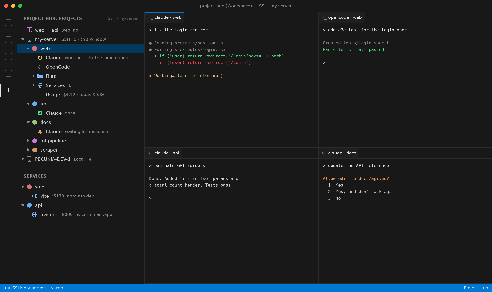
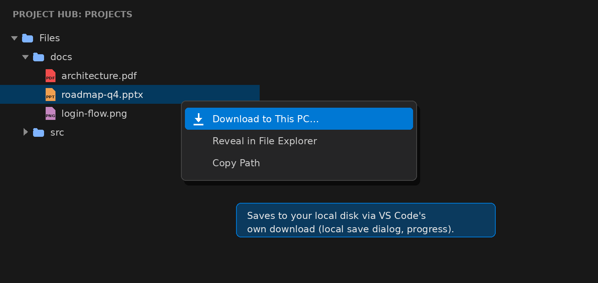
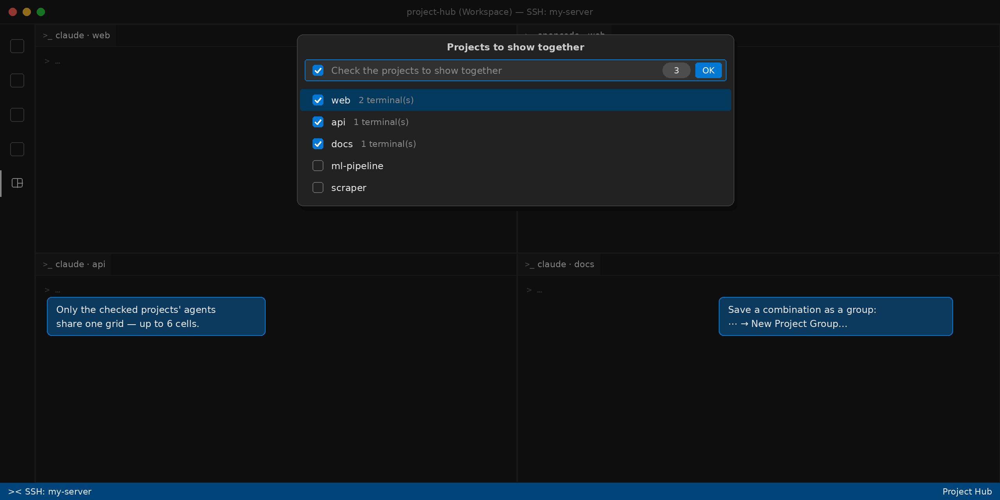
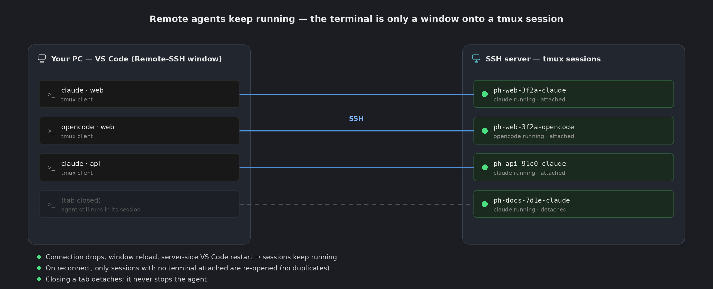

# Project Hub — Multi-Project & Agent Workspace

**One VS Code window, many projects, isolated AI agent sessions.**

Switch projects from a sidebar list without reloading the window — terminals and your Claude / Codex / Gemini / Antigravity / OpenCode sessions keep running in the background, and a notification (with a one-click **Switch to Project** button) tells you when an agent finishes or needs your input. Projects on your other PCs and SSH servers show up in the same list.

**English** · [한국어](README.ko.md) · [简体中文](README.zh-CN.md) · [日本語](README.ja.md)

*UI languages: English · 한국어 · 日本語 · 简体中文 · 繁體中文 (follows the VS Code display language).*



## Patch notes

### 0.22.3
- **Fix: a new SSH server could show another server's projects.** The project list backup kept on your PC was keyed by hostname. After a server was renamed, a new server given the old name restored the old server's list and showed projects whose folders don't exist there. Backups are now keyed by the connection address (`user@IP`), and a restore keeps only projects whose folder exists on that machine.

### 0.22.2 — Download from a remote
- **Download to This PC…** — in a remote (SSH) window, right-click a file or folder in the Files tree to save it to your local machine: PDFs, slides, images, anything you'd rather open with a local app. It uses VS Code's own download (local save dialog, progress, folders).



### 0.22.1
- **Fix: Add Project in a remote window** — the folder picker turned into a checkbox list and folders couldn't be opened. Remote windows now pick one folder at a time; local windows still pick several at once.

### 0.22.0 — Project groups & chosen-project grids
- **Choose projects…** — the ⫽ grid button can show only the agents of the projects you check, side by side in one grid.
- **Project groups** — save a combination (**⋯ → New Project Group…**); it sits at the top of the list and opens its grid in one click.
- **Remote agent terminals are the tmux client itself** — nothing is ever typed into an agent's prompt by mistake, and VS Code's own terminal restore re-attaches by itself.
- **Fix:** reloading a remote window no longer doubles every agent terminal; repeat clicks on a project of another machine no longer open two windows (a *Connecting to …* indicator shows during the SSH check).



### 0.21.0 – 0.21.2
- **Services & background processes on Linux**, SSH remotes included — read straight from `/proc`, servers attributed by working directory, tmux panes followed, stop is SIGTERM → SIGKILL.
- **Fix:** after a remote restart, `tmux attach …` could be typed into a running agent's prompt.

### 0.20.0
- **Choose the auto-start agent** — pick which agent starts on switch (**Select Default Agent**), or be asked every time (`projectHub.autoStartAgent` = `ask`).
- **Fix:** an empty pane on the left of the grid after switching in a remote window.

---

## Why Project Hub

Terminal multiplexers built for agents (such as herdr) and standalone agent desktop apps (such as Orca) are good at running many agents. Project Hub is built for the other half of the day: **the code, the editor, and the servers those agents touch — without leaving VS Code.**

- **Stay in your editor.** No second app, no second terminal emulator. Your editor, debugger, Git view, extensions and keybindings all stay where they are; Project Hub only adds a sidebar.
- **Exact agent status, not guesses.** Claude, Codex, Gemini and Antigravity report *working / done / waiting for you* through their own hooks, so the status is what the agent says — not a pattern match on terminal output. A toast with **Switch to Project** and a briefing feed of finished work come with it.
- **Your dev servers, per project.** Every server an agent started shows up under its project with its port — open it, stop it, or restart it with the command you used last. Works on Windows and Linux, including SSH remotes.
- **Every machine in one list.** Projects on your PC and on each SSH server sit in one tree. On a server, agents run inside tmux automatically, so a dropped connection or a window reload never kills them.
- **First-class Windows.** PowerShell, cmd and Git Bash are supported end to end — notifications, process tree, services.
- **You stay in control.** Agents never message or drive each other. A person types; the agent's CLI runs it. Groups and grids are for *watching* several agents at once, not for wiring them together.

| | Project Hub | Agent terminal multiplexer<br>(e.g. herdr) | Standalone agent app<br>(e.g. Orca) |
|---|---|---|---|
| Where it runs | Inside VS Code | Inside your terminal | Separate desktop app |
| Full code editor, debugger, Git UI | ✅ VS Code itself | — | Basic |
| Agent status | Agent hooks (exact) | Output heuristics | Activity indicators |
| Dev servers & ports per project | ✅ open / stop / restart | — | Built-in browser |
| Local PC + SSH servers in one list | ✅ | Remote mode | ✅ |
| Agents survive disconnects on remotes | ✅ tmux, automatic | ✅ own server | Auto-reconnect |
| Windows | ✅ | — | ✅ |
| Per-project token usage & cost | ✅ | — | — |
| One git worktree per agent | — | — | ✅ |
| Agents directing other agents | — by design | Experimental | ✅ |

<sub>Comparison as of November 2026, based on each project's public documentation; "—" means not offered or not mentioned there. If something here is out of date, please open an issue.</sub>

## The problem this solves

Running several AI agents across several repos normally means one VS Code window per repo. Opening a folder in an existing window (`openFolder`) reloads it and kills every terminal, so your agent sessions die with it.

Project Hub keeps **one** window. Projects swap inside a hub workspace, so the Explorer changes while every terminal and agent session stays alive. You leave an agent working on project A, go do something on project B, and get a toast when A is done.

## Features

**Instant project switching** — no window reload, no extension-host restart. The Explorer swaps; terminals don't.

**Isolated agent sessions** — per-project, per-agent terminals. Sessions are keyed by working directory, so projects never collide. The same agent can run several sessions in one project, tracked as separate rows.

**Create or add projects** — register existing folders, or create a brand-new project folder and switch straight into it.

**Browse files without switching** — every project has a `Files` node with a lazy-loaded file tree that uses your file icon theme and Git status colours, so you can look inside another project without leaving the one you're working in.

**Notifications** — toast plus an activity-bar badge when an agent finishes, asks a question, or waits for permission. Hooks install once, user-globally.

**See what's running** — per-agent status rows showing the prompt you gave (`Claude working… fix the login bug`), a **Services** section listing every dev server your agents started (with one-click stop), and a background-process tree per project.

**Briefing feed** — a card feed of what finished while you were away, summarised from each agent's last response. Persisted across restarts, last 200 entries.

**Send instructions without switching** — right-click a project, type, and it goes straight to that project's agent terminal.

**Project terminal grid** — on each switch, only the active project's agent terminals are shown, in a 2-column editor grid. Other projects' terminals wait in the closed panel, still running. A one-click *all projects* view puts each project in its own cell with its terminals as tabs.

**Usage & cost** — per-project Claude token usage and estimated cost, aggregated from saved sessions.

**Editor tab restore** — each project remembers and restores its open tabs on switch.

## Requirements

| | |
|---|---|
| VS Code | 1.93.0 or newer |
| `curl` | Used by the notification hooks. Bundled with Windows 10+, macOS, and most Linux distros. |
| Agent CLIs | Whichever you use — `claude`, `gemini`, `codex`, `agy`. Must be on your `PATH`. |
| OS | Cross-platform. The Services and Background Processes views support Windows and Linux (including SSH remotes); not yet macOS. |

## Install

**From the VS Code Marketplace (recommended)**

1. In VS Code, open the Extensions view (`Ctrl+Shift+X` / `Cmd+Shift+X`).
2. Search for **Project Hub** and click **Install** — or open it directly: [PecuniaEstAI.projecthub](https://marketplace.visualstudio.com/items?itemName=PecuniaEstAI.projecthub).

**Offline / manual install (.vsix)**

```bash
code --install-extension projecthub-<version>.vsix
```

Or: Extensions view → `...` menu (top right) → **Install from VSIX…** → pick the file.

Reload the window when prompted. The **Project Hub** icon appears in the activity bar.

**Upgrading from "Project Hub for Claude Code" (`pecuniaestai.claude-project-hub`)**: the extension ID changed to `pecuniaestai.projecthub`, so VS Code treats it as a new extension. Install the new one, then uninstall the old one — Project Hub warns while both are installed. Your project list (`~/.project-hub/`) and avatars carry over, and the hub workspace offers a one-time migration. Per-project editor tabs, session names, and the PC/server list start fresh (the list refills as you open windows).

> Upgrading: update from the Marketplace (Extensions view → filter **Installed** → **Update**), or install the newer `.vsix` the same way — VS Code replaces the previous version in place. Your project list, colours, and briefing history live outside the extension (in `~/.project-hub/`), so they survive upgrades and reinstalls.

## Getting started

1. Click the **Project Hub** icon in the activity bar.
2. **Add Project** (`+`) registers existing folders. **Create New Project** (new-folder icon) creates a folder and registers it in one step, then switches to it.
3. Click a project to switch. The first click reopens the window once into the hub workspace; every switch after that is instant.
4. Start an agent with the terminal button (▶ default agent) or the robot button (🤖 pick an agent). Notification hooks install automatically on first launch.
5. Work on another project while agents run. You'll get a toast when one finishes or needs you — click **Switch to Project** to jump back.

Status rows under each project: `🔄 working…` · `✅ done` · `🔔 waiting for response`, with the prompt text you submitted shown alongside.

> **Do not remove the `⌂ Hub` folder from the workspace.** VS Code restarts every extension when the *first* workspace folder changes. That small pinned folder permanently occupies the first slot so projects can swap in the second slot without restarting anything — including Claude Code itself.

## Multi-agent

Agents are defined in the `projectHub.agents` setting. Built-in defaults:

| Agent | New session | Resume last | Resume specific |
|---|---|---|---|
| Claude | `claude` | `claude --continue` | `claude --resume {sessionId}` |
| Gemini | `gemini` | `gemini --resume` | — |
| Codex | `codex` | `codex resume --last` | — |
| Antigravity | `agy` | `agy --continue` | `agy --conversation {sessionId}` |
| OpenCode | `opencode` | `opencode --continue` | `opencode --session {sessionId}` |
| Terminal | *(shell only)* | — | — |

- Add any CLI by appending to the array — known ids auto-fill missing fields.
- Switching to a project with no open session auto-starts `projectHub.defaultAgent` (`claude` by default), which is also the default terminal button. Run **Project Hub: Select Default Agent** to pick it from a list, or choose *Ask every time* (`projectHub.autoStartAgent` = `ask`) to get a picker on each such switch — the 📌 button on an item makes it the default. Turn auto-start off with `projectHub.autoStartClaudeOnSwitch`.
- Notifications work out of the box for Claude, Codex, Gemini, and Antigravity. OpenCode (plugin-based, no hooks) and the plain Terminal entry have none. Custom agents can be wired manually by POSTing `{"cwd": "..."}` to `http://127.0.0.1:43917/hook/stop?agent=<id>`.

## Sessions after a VS Code restart

Terminal processes die on a full restart, but conversation history is preserved (e.g. `~/.claude/projects/<encoded path>`).

- **⏱ Resume** restores the last conversation (`claude --continue`).
- Right-click → **Open a Claude Session** lists saved sessions with previews. Each opens in its own terminal (`claude --resume <id>`), so several sessions can run in parallel.
- **Automatic re-run**: VS Code restores agent terminals as plain shells. A few seconds after startup, Project Hub re-runs the agent in each of them — the last session for a default terminal, that session for a Claude session terminal. Only shells started fresh by this launch are touched; after a window reload, or in a terminal where you quit the agent yourself, nothing is sent. Works on Windows and Linux (not yet macOS). Turn off with `projectHub.resumeAgentsOnRestart`.

## Remote (SSH)

Under Remote-SSH the extension runs on the remote host, so agent terminals, the project list (`~/.project-hub/`) and notification hooks all live there. Install the extension in the remote window — from the Marketplace (Extensions view → search **Project Hub** → **Install in SSH: …**), or from a VSIX if the remote has no network access — and put the agent CLIs on the remote `PATH`.

> **Set up an SSH key first.** With password login, Remote-SSH asks for the password **several times per connection** (host check, server install check, the connection itself), and again on every new window, reload, or reconnect — Project Hub opens a new window whenever you click a project on another device, so this adds up fast. Remote-SSH cannot store passwords.
>
> - **Automatic**: in a local window, run **Project Hub: Set Up SSH Key for a Server** (or right-click a server group in the list). It creates `~/.ssh/id_ed25519` if you have none, opens a terminal where you type the server password **once**, adds the public key to the server's `~/.ssh/authorized_keys`, and checks that key login works. Clicking a project on a server without key login offers this first.
> - **Manual** (PowerShell): `ssh-keygen -t ed25519`, then
>   `type $env:USERPROFILE\.ssh\id_ed25519.pub | ssh user@server "mkdir -p ~/.ssh && chmod 700 ~/.ssh && cat >> ~/.ssh/authorized_keys && chmod 600 ~/.ssh/authorized_keys"`
> - If key login still fails, the server may disallow it — ask its admin to check `PubkeyAuthentication yes` in `/etc/ssh/sshd_config`.

A dropped connection keeps remote terminals alive only for a while; a remote server restart or update ends them. So in a remote window Project Hub always tries to keep agents running on its own:

- **tmux installed**: each agent runs in its own tmux session (`ph-<project>-<hash>-<agent>`, mouse scrolling on), and the agent terminal *is* the tmux client (`tmux new-session -A …`) — nothing is typed into a shell, so nothing can land in an agent's prompt. On reconnect, Project Hub re-opens a terminal only for its sessions that have **no terminal attached**, so a window reload never duplicates terminals.
- **Closing an agent tab only detaches.** The agent keeps running in its session and comes back the next time a window opens. To really stop it, quit the agent and its shell (e.g. `/exit`, then `exit`), or run `tmux kill-session -t '=ph-…'`.
- **tmux missing**: agents run in plain terminals as before, with a one-time notice (*Don't Show Again* available). tmux is checked on every launch, so installing it later takes effect immediately.
- Local windows are unaffected. Services and Background Processes work on a Linux remote too, including servers an agent started inside tmux.
- After a full VS Code restart, restored agent terminals re-attach to their tmux session instead of starting a second agent (`projectHub.resumeAgentsOnRestart`).



**One list across PCs and servers.** A VS Code window connects to one place only, so each PC and server keeps its own project list, and switching stays within that place. Every window also shares its list with the others:

- The view title shows where this window is connected, e.g. `Local · PECUNIA-DEV-1` or `SSH · my-server`.
- Once another PC or server is known, the list becomes **device → projects**: this window's device comes first (expanded, marked *this window*), the others follow at the same level (`device-desktop` icon for a PC, `remote` icon for an SSH server). With a single device the projects are listed directly. A server shows up once you have opened a window on it with Project Hub installed.
- Clicking a project in another group opens a window connected there and switches it to that project. If that window is already open, VS Code moves to it instead. It is always a separate window.
- Right-click a group → **Hide This PC/Server from the List**; it reappears the next time a window opens there.
- SSH groups reconnect as `user@<server IP>`. A non-standard port or key must be set in `~/.ssh/config` under that IP.

## Services & processes

- The **Services** section lists every process listening on a port that belongs to a registered project — grouped by project, with per-service and per-project stop buttons, plus a **Restart Service** action that remembers the command you used. Detection works even for servers started detached or from another window, matched by command line and process ancestry.
- Web services get an **Open in Browser** button that opens `http://localhost:<port>`. Known non-HTTP ports and processes — PostgreSQL, MySQL, Redis, MongoDB, the Node inspector, and so on — don't get one. Ports 443 and 8443 open over https. If a service listens on several web ports you're asked which to open, and the tooltip lists them as clickable links.
- Each project also has a **Background Processes** node showing everything under its agent terminals. MCP servers and internal helpers are hidden by default (the "N hidden" row toggles them).

## Browsing project files

Each project row has a **Files** node — a file tree of that project, right in the sidebar.

- Directories are read **one level at a time, only when you expand them**, so a large repository costs nothing until you look into it.
- Rows carry the real file URI, so you get your **file icon theme** and **Git status colours** exactly as in the Explorer.
- Clicking a file opens it in a preview tab. With `projectHub.switchOnRowClick` on (the default) it switches to that project first; turn it off to peek into another project without moving the Explorer.
- Right-click a file or folder for **Reveal in File Explorer** and **Copy Path**.
- In a remote (SSH) window, right-click → **Download to This PC…** saves a file or folder to your local machine — for PDFs, slides, images and anything else you'd rather open with a local app. It uses VS Code's own Explorer download (local save dialog, progress, folders), so the sidebar briefly shows the Explorer; a file of another project switches to that project first.
- `projectHub.fileTreeExclude` hides names you don't want listed (`.git`, `node_modules`, … by default). Matching is on the exact name, not a glob.
- The tree is read on expand — use **Project Hub: Refresh**, or collapse and expand, to pick up files created outside VS Code.

## Terminal layout

VS Code offers no way to filter the terminal tab list by project, so Project Hub shows only the active project's terminals by moving them into the editor area.

- **Project grid** (`projectHub.projectTerminalGrid`, on by default): on every switch, the active project's agent terminals fill the editor area in a 2-column grid (one terminal per cell, up to 6). Other projects' terminals go back to the closed panel with sessions intact. Opening another agent for the active project rebuilds the grid. Open files stay as background tabs in the first cell.
- **⫽ button**: arrange on demand. *All projects* gives each project one cell with its terminals as tabs; *active project only* gives each terminal its own cell. With the project grid on, the next switch or new agent returns to the active-project grid.
- **Choose projects**: the ⫽ button also offers *Choose projects…* — check two or more projects and only their agents share one grid (one cell per agent up to 6, otherwise one cell per project with its agents as tabs). Projects with no agent running get the default agent started (unless `projectHub.autoStartClaudeOnSwitch` is off). The last selection is pre-checked next time. While this grid is up, opening an agent does not snap back to the active-project grid; switching to a project does.
- **Project groups**: save a combination you use often. **⋯ → New Project Group…** picks the projects and a name; the group appears at the top of the list, and clicking it shows that grid. Edit (✎) and delete (🗑) are on the row. Groups are saved per machine in `~/.project-hub/projects.json`; deleting a group does not touch its projects or agents.
- **Constraints of the multi-project grid**:
  - One window connects to one machine, so a grid can only hold projects of that machine — local and SSH-server projects cannot share a grid.
  - Up to 6 cells; beyond that, extra terminals go into the last cell as tabs.
  - It is a view for **you** to watch and type into several agents. Project Hub does not relay messages between agents: agents do not talk to each other — a person types into a terminal and that agent's CLI runs it.
- With the project grid off: `projectHub.splitAgentTerminals` opens a project's next agent split beside its existing terminal, and `projectHub.terminalsInEditor` opens agent terminals as editor tabs.
- VS Code auto-locks editor groups that contain only a terminal (`workbench.editor.autoLockGroups`), so files you open go to another group. Project Hub unlocks and closes empty groups before each rearrangement.
- Right-click any terminal → **Attach This Terminal to a Project** to adopt a terminal you opened yourself.

## Briefing & usage

- **Briefing**: a webview card feed of completed work and attention requests, with the agent's last response as the summary. Expand with *Show more*, click the project name to switch.
- **Usage**: projects with Claude sessions show a Usage row — total and today's estimated cost, with a per-model breakdown in the tooltip. Estimates use list prices (cache write 1.25×, cache read 0.1×). On a subscription plan this is an API-equivalent estimate, not a bill.

## Commands

Available from the Command Palette (`Ctrl+Shift+P`):

| Command | What it does |
|---|---|
| Project Hub: Add Project | Register existing folders (several at once locally, one at a time in a remote window) |
| Project Hub: Create New Project | Create a folder, register it, switch to it |
| Project Hub: Add Current Folder as Project | Register the folder currently open |
| Project Hub: Quick Switch Project | Fuzzy-pick a project (also on the status bar) |
| Project Hub: Arrange Agent Terminals in Grid | 2-column editor grid (all / active project / chosen projects / a group) |
| Project Hub: New Project Group… | Save projects to show together in one grid |
| Project Hub: Show Project Group in Grid | Show a saved group's agents in one grid |
| Project Hub: Set Up SSH Key for a Server | Register an SSH key with one password entry (local window) |
| Project Hub: Attach This Terminal to a Project | Adopt a terminal you opened yourself |
| Project Hub: Set Up Completion Notifications | (Re)install the global hooks |
| Project Hub: Refresh | Re-query processes, usage, and the tree |

Right-click a project row for per-project actions: resume, pick a session, open with a specific agent, send an instruction, set an identification colour, remove from the list.

## Settings

| Setting | Default | Description |
|---|---|---|
| `projectHub.port` | `43917` | Local HTTP port for notifications (reinstall hooks after changing) |
| `projectHub.agents` | Claude/Gemini/Codex/Antigravity/OpenCode/Terminal | Agent list (id, label, command, resumeCommand, resumeSessionCommand) |
| `projectHub.defaultAgent` | `claude` | Agent used for auto-start and the default terminal button |
| `projectHub.focusClaudeTerminalOnSwitch` | `true` | Reveal the project's terminal on switch |
| `projectHub.switchOnRowClick` | `true` | Clicking an agent, usage, or service row switches to that project first |
| `projectHub.autoStartClaudeOnSwitch` | `true` | Auto-start the default agent if the project has no terminal |
| `projectHub.autoStartAgent` | `default` | What auto-start opens: `default` = `projectHub.defaultAgent`, `ask` = pick an agent each time |
| `projectHub.autoInstallHooks` | `true` | Install notification hooks automatically |
| `projectHub.restoreEditorsOnSwitch` | `true` | Save and restore editor tabs per project |
| `projectHub.projectTerminalGrid` | `true` | Show only the active project's agent terminals, in an editor grid |
| `projectHub.resumeAgentsOnRestart` | `true` | Re-run agents in terminals restored after a full VS Code restart |
| `projectHub.splitAgentTerminals` | `true` | Open a project's next agent split beside its existing terminal (project grid off only) |
| `projectHub.terminalsInEditor` | `false` | Open agent terminals as editor tabs (project grid off only) |
| `projectHub.fileTreeExclude` | `.git`, `node_modules`, `.venv`, `__pycache__`, `dist`, `out`, `.next` | Names hidden in the Files tree (exact name, not a glob) |
| `projectHub.showAllProcesses` | `false` | Show MCP servers and helpers in the process list |
| `projectHub.windowColor` | `false` | Tint the title bar with the project colour |
| `projectHub.notifyForActiveProject` | `true` | Notify for the active project too (when unfocused) |
| `projectHub.notificationTimeout` | `10` | Auto-hide toasts after N seconds (0 = keep) |

## How it works

- **No-reload switching**: replacing the whole folder (`openFolder`) reloads the window and kills every terminal. Project Hub instead swaps folders inside a hub workspace (`.code-workspace`) via `updateWorkspaceFolders`, so the Explorer switches while terminals and agent sessions stay alive.
- **Anchor folder (`⌂ Hub`)**: VS Code restarts all extensions when the first workspace folder changes. A small pinned folder occupies that slot permanently; projects swap in the second slot only.
- **Session isolation**: each agent runs in a dedicated terminal with the project as its working directory. The CLIs scope sessions by cwd, so projects never share a session.
- **Notifications**: hooks are installed once, in user-global config — Claude `~/.claude/settings.json`, Codex `~/.codex/hooks.json`, Gemini `~/.gemini/settings.json`, Antigravity `~/.gemini/antigravity-cli/hooks.json`. On each event the hook POSTs to a local HTTP server; the payload's working directory identifies the project. Nothing is written into your repositories. On Windows the command is `curl.exe … -d '@-'`, which means the same in Git Bash (Claude) and PowerShell (Gemini runs hooks with `powershell -Command`, where plain `curl` is an alias for `Invoke-WebRequest`).
- **Where your data lives**: project list and project groups (`projects.json`), briefing history, and saved restart commands are in `~/.project-hub/` on each machine. Token usage is read (never written) from the agent CLIs' own session files.

## Troubleshooting

**No notifications arrive.**
Run **Project Hub: Set Up Completion Notifications** to reinstall the hooks, then restart any running agent sessions — a session picks up hooks at start. If you changed `projectHub.port`, the hooks must be reinstalled to match.

**Gemini never notifies on Windows (before 0.18.4).**
Gemini runs hooks through PowerShell, and the old `curl … -d @-` command failed there. 0.18.4 switches to `curl.exe … -d '@-'` and reinstalls outdated hooks the next time you open the agent from Project Hub (or run **Set Up Completion Notifications**). Restart running Gemini sessions afterwards.

**Clicking a *waiting* / *done* row opened the same session in a second terminal (before 0.18.4).**
Switching to the project cleared those statuses before the row checked whether the session was alive, so it was resumed again with `--resume`. Fixed: liveness is checked before switching, and an existing terminal of that agent is shown instead. If two terminals still share one conversation, quit one of them with `/exit`.

**"Port is already in use" warning.**
Another window or program holds the port. The hub-workspace window owns it by preference and other windows hand it over automatically, so closing the other VS Code window usually resolves it. If a different program holds it, change `projectHub.port` and reinstall the hooks.

**Every switch restarts all extensions.**
The `⌂ Hub` anchor folder was removed from the workspace. Switch projects once and it is recreated in the first slot.

**A project's Services section is empty although a dev server is running.**
Service detection works on Windows and Linux (not yet macOS). Servers are matched by command line and process ancestry, and on Linux also by working directory — so `npm run dev` started inside the project folder is attributed even though the path never appears. On Windows, a server launched in a way that never mentions the project path may not be attributed; it will still appear under **Background Processes** if it was started from an agent terminal. On Linux, only your own user's processes are visible.

**I clicked a row under a project, but the Explorer still shows the previous project.**
Clicking an agent, usage, or service row switches to that project by default. If it doesn't, `projectHub.switchOnRowClick` is off — that setting exists so you can look at another project's terminal without moving the Explorer. The project row itself always switches.

**An agent exits by itself in a Python project; the terminal shows `Activate.ps1` / `deactivate` lines.**
The Python Environments extension activates virtual environments by typing commands into terminals. When a project switch changes the workspace folders, it re-types `deactivate` and the activate command into terminals where an agent is already running, and the agent exits. Stop it from typing into terminals in your user settings:

```json
"python-envs.terminal.autoActivationType": "off"
```

`shellStartup` also avoids typed commands, but edits your PowerShell profile. Agents normally find the project's `.venv` on their own.

**The first character of the agent command is missing (`laude --continue`).**
Fixed in 0.15.4: commands are sent once the shell reports it is ready (shell integration), or after 4 seconds for shells without it.

**The hook seems to block my agent.**
It cannot. Hooks use `curl` with a 3-second timeout and fail silently when the server is down.

## Limitations

- Services and Background Processes support Windows (PowerShell) and Linux (`/proc`); macOS is not supported yet. Everything else is cross-platform.
- No agent-to-agent communication: every agent is an independent CLI that runs what a person types into its terminal. The multi-project grid only puts them side by side.
- A grid holds only the projects of the machine the window is connected to (no mixing local and SSH projects).
- Codex `resume --last` cwd filtering requires a 2026+ CLI.
- Antigravity hook events follow current public docs — please report if notifications don't fire.
- Usage figures are estimates from list prices, not billing data.

## License

MIT
