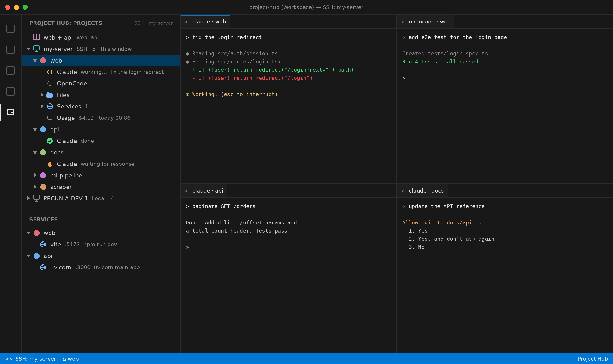
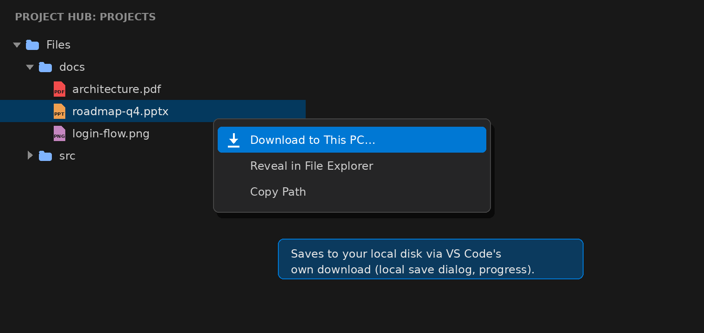
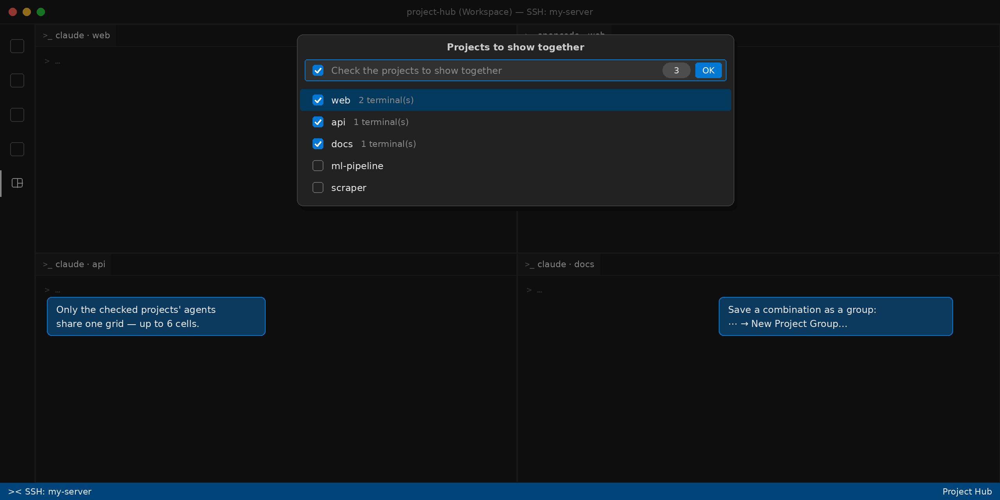
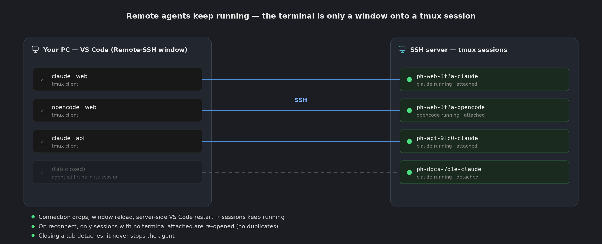

# Project Hub — Multi-Project & Agent Workspace

**一个 VS Code 窗口，多个项目，彼此隔离的 AI 代理会话。**

在侧边栏列表中切换项目，无需重新加载窗口——终端以及 Claude / Codex / Gemini / Antigravity / OpenCode 会话都在后台继续运行；代理完成任务或需要你回应时会弹出通知，点击 **切换到项目** 按钮即可一键回到该项目。其他 PC 和 SSH 服务器上的项目也显示在同一列表中。

[English](README.md) · [한국어](README.ko.md) · **简体中文** · [日本語](README.ja.md)

*界面语言：English · 한국어 · 日本語 · 简体中文 · 繁體中文（跟随 VS Code 显示语言）。*



## 更新日志

### 0.22.3
- **修复：新的 SSH 服务器可能显示其他服务器的项目。** 保存在本机上的项目列表备份原先以主机名区分。服务器改名后，若新服务器沿用了旧名称，就会恢复旧服务器的列表，显示一些在该服务器上并不存在的文件夹对应的项目。现在备份改为以连接地址（`user@IP`）区分，恢复时只保留文件夹在该机器上确实存在的项目。

### 0.22.2 — 从远程下载
- **下载到此电脑…** —— 在远程（SSH）窗口中，右键单击 **文件** 树中的文件或文件夹，即可保存到本地：PDF、幻灯片、图片，以及任何你更想用本地应用打开的文件。使用的是 VS Code 自带的下载功能（本地保存对话框、进度显示、支持文件夹）。



### 0.22.1
- **修复：远程窗口中的 添加项目** —— 文件夹选择器变成了复选框列表，无法进入文件夹。现在远程窗口每次选择一个文件夹，本地窗口仍可一次选择多个。

### 0.22.0 — 项目组与自选项目网格
- **选择项目…** —— ⫽ 网格按钮可以只显示你勾选的项目的代理，并排放在同一个网格中。
- **项目组** —— 保存常用组合（**⋯ → 新建项目组…**）；项目组位于列表顶部，单击即可打开其网格。
- **远程代理终端本身就是 tmux 客户端** —— 不会再有命令被误输入到代理的提示符中，VS Code 自带的终端恢复功能也会自动重新连接。
- **修复：** 重新加载远程窗口不再导致每个代理终端翻倍；反复点击另一台机器上的项目不再打开两个窗口（SSH 检查期间会显示 *正在连接 …* 提示）。



### 0.21.0 – 0.21.2
- **Linux 上的服务与后台进程**（包括 SSH 远程）—— 直接读取 `/proc`，按工作目录归属服务器，跟踪 tmux 窗格，停止方式为 SIGTERM → SIGKILL。
- **修复：** 远程重启后，`tmux attach …` 可能被输入到正在运行的代理提示符中。

### 0.20.0
- **选择自动启动的代理** —— 选择切换时启动哪个代理（**选择默认代理**），或每次询问（`projectHub.autoStartAgent` = `ask`）。
- **修复：** 在远程窗口中切换后，网格左侧出现空白窗格。

---

## 为什么选择 Project Hub

面向代理的终端复用器（如 herdr）和独立的代理桌面应用（如 Orca）擅长同时运行大量代理。Project Hub 关注的是一天中的另一半工作：**代理所触及的代码、编辑器和服务器——全程不离开 VS Code。**

- **留在编辑器里。** 不需要第二个应用，也不需要第二个终端模拟器。编辑器、调试器、Git 视图、扩展和快捷键都保持原样；Project Hub 只是多了一个侧边栏。
- **准确的代理状态，而非猜测。** Claude、Codex、Gemini 和 Antigravity 通过各自的钩子报告 *工作中 / 已完成 / 等待你回应*，因此状态就是代理自己报告的结果——而不是对终端输出的模式匹配。同时还提供带 **切换到项目** 按钮的通知弹窗，以及汇总已完成工作的简报。
- **按项目管理开发服务器。** 代理启动的每个服务器都会连同端口显示在所属项目下——可以打开、停止，或用上次使用的命令重启。支持 Windows 和 Linux，包括 SSH 远程。
- **所有机器一个列表。** 本机和各台 SSH 服务器上的项目都在同一棵树中。在服务器上，代理会自动运行在 tmux 中，连接断开或窗口重新加载都不会结束它们。
- **一流的 Windows 支持。** PowerShell、cmd 和 Git Bash 全面支持——通知、进程树、服务。
- **一切由你掌控。** 代理之间从不互相发送消息或相互驱动。由人输入，代理的 CLI 执行。项目组和网格用于同时 *查看* 多个代理，而不是把它们串联起来。

| | Project Hub | 代理终端复用器<br>（如 herdr） | 独立代理应用<br>（如 Orca） |
|---|---|---|---|
| 运行位置 | VS Code 内部 | 终端内部 | 独立桌面应用 |
| 完整的代码编辑器、调试器、Git 界面 | ✅ 即 VS Code 本身 | — | 基础功能 |
| 代理状态 | 代理钩子（准确） | 基于输出推断 | 活动指示 |
| 按项目管理开发服务器和端口 | ✅ 打开 / 停止 / 重启 | — | 内置浏览器 |
| 本机与 SSH 服务器在同一列表 | ✅ | 远程模式 | ✅ |
| 远程断线后代理继续运行 | ✅ tmux，自动 | ✅ 自有服务端 | 自动重连 |
| Windows | ✅ | — | ✅ |
| 按项目统计令牌用量与费用 | ✅ | — | — |
| 每个代理一个 git worktree | — | — | ✅ |
| 代理指挥其他代理 | — 有意不支持 | 实验性 | ✅ |

<sub>对比截至 2026 年 11 月，依据各项目的公开文档；“—”表示未提供或文档中未提及。如有过时内容，欢迎提交 issue。</sub>

## 解决的问题

在多个仓库中同时运行多个 AI 代理，通常意味着每个仓库开一个 VS Code 窗口。在现有窗口中打开文件夹（`openFolder`）会重新加载窗口并结束所有终端，代理会话也随之终止。

Project Hub 只用 **一个** 窗口。项目在 hub 工作区内切换，资源管理器随之变化，而所有终端和代理会话都保持运行。你可以让代理在项目 A 上工作，转去项目 B 处理别的事，A 完成时会收到通知。

## 功能

**即时切换项目** —— 不重新加载窗口，不重启扩展宿主。资源管理器切换，终端不动。

**隔离的代理会话** —— 按项目、按代理分配独立终端。会话以工作目录区分，项目之间互不冲突。同一代理可以在一个项目中运行多个会话，各自显示为独立的行。

**新建或添加项目** —— 注册现有文件夹，或新建一个项目文件夹并直接切换过去。

**无需切换即可浏览文件** —— 每个项目都有一个 `文件` 节点，提供按需加载的文件树，沿用你的文件图标主题和 Git 状态颜色，不离开当前项目就能查看其他项目的内容。

**通知** —— 代理完成任务、提出问题或等待权限时，弹出通知并在活动栏显示徽标。钩子只需在用户全局安装一次。

**查看运行状态** —— 每个代理的状态行会显示你下达的提示词（`Claude 工作中… 修复登录 bug`）；**服务** 区域列出代理启动的所有开发服务器（可一键停止）；每个项目还有一棵后台进程树。

**简报** —— 以卡片流展示你离开期间完成的工作，内容摘自各代理的最后一条回复。重启后仍保留，最多 200 条。

**无需切换即可发送指令** —— 右键单击项目，输入内容，即可直接发送到该项目的代理终端。

**项目终端网格** —— 每次切换时，只在双列编辑器网格中显示活动项目的代理终端。其他项目的终端在关闭的面板中等待，仍在运行。一键切换到 *所有项目* 视图，每个项目占一个单元格，其终端以标签页形式排列。

**用量与费用** —— 汇总已保存的会话，按项目统计 Claude 令牌用量和估算费用。

**编辑器标签页恢复** —— 每个项目会记住已打开的标签页，并在切换时恢复。

## 环境要求

| | |
|---|---|
| VS Code | 1.93.0 或更高版本 |
| `curl` | 通知钩子使用。Windows 10+、macOS 和大多数 Linux 发行版自带。 |
| 代理 CLI | 按需安装——`claude`、`gemini`、`codex`、`agy`。必须位于 `PATH` 中。 |
| 操作系统 | 跨平台。服务和后台进程视图支持 Windows 和 Linux（包括 SSH 远程），暂不支持 macOS。 |

## 安装

**从 VS Code 扩展市场安装（推荐）**

1. 在 VS Code 中打开扩展视图（`Ctrl+Shift+X` / `Cmd+Shift+X`）。
2. 搜索 **Project Hub** 并点击 **安装**——或直接打开：[PecuniaEstAI.projecthub](https://marketplace.visualstudio.com/items?itemName=PecuniaEstAI.projecthub)。

**离线 / 手动安装（.vsix）**

```bash
code --install-extension projecthub-<version>.vsix
```

或者：扩展视图 → 右上角 `...` 菜单 → **从 VSIX 安装...** → 选择文件。

按提示重新加载窗口后，活动栏中会出现 **Project Hub** 图标。

**从 "Project Hub for Claude Code"（`pecuniaestai.claude-project-hub`）升级**：扩展 ID 已改为 `pecuniaestai.projecthub`，VS Code 会将其视为新扩展。请先安装新扩展，再卸载旧扩展——两者同时安装时 Project Hub 会发出警告。项目列表（`~/.project-hub/`）和头像会沿用，hub 工作区会提示进行一次性迁移。各项目的编辑器标签页、会话名称以及 PC/服务器列表将重新开始（打开窗口后列表会逐步重新填充）。

> 升级：在扩展市场中更新（扩展视图 → 筛选 **已安装** → **更新**），或用同样的方式安装更新的 `.vsix`——VS Code 会原地替换旧版本。项目列表、颜色和简报历史保存在扩展之外（`~/.project-hub/`），因此升级和重装后都会保留。

## 快速上手

1. 点击活动栏中的 **Project Hub** 图标。
2. **添加项目**（`+`）注册现有文件夹。**新建项目**（新建文件夹图标）一步完成创建文件夹和注册，然后切换过去。
3. 点击项目即可切换。首次点击会将窗口重新打开一次，进入 hub 工作区；之后的每次切换都是即时的。
4. 用终端按钮（▶ 默认代理）或机器人按钮（🤖 选择代理）启动代理。通知钩子会在首次启动时自动安装。
5. 代理运行时去处理其他项目。代理完成或需要你回应时会弹出通知——点击 **切换到项目** 即可跳回。

每个项目下的状态行：`🔄 工作中…` · `✅ 任务完成` · `🔔 等待回应`，旁边显示你提交的提示词。

> **不要从工作区中移除 `⌂ Hub` 文件夹。** 工作区的 *第一个* 文件夹发生变化时，VS Code 会重启所有扩展。这个固定的小文件夹永久占据第一个位置，使项目可以在第二个位置切换而不重启任何东西——包括 Claude Code 本身。

## 多代理

代理在 `projectHub.agents` 设置中定义。内置默认值：

| 代理 | 新会话 | 继续上次会话 | 继续指定会话 |
|---|---|---|---|
| Claude | `claude` | `claude --continue` | `claude --resume {sessionId}` |
| Gemini | `gemini` | `gemini --resume` | — |
| Codex | `codex` | `codex resume --last` | — |
| Antigravity | `agy` | `agy --continue` | `agy --conversation {sessionId}` |
| OpenCode | `opencode` | `opencode --continue` | `opencode --session {sessionId}` |
| Terminal | *（仅 shell）* | — | — |

- 向数组追加条目即可添加任意 CLI——已知 id 会自动补全缺失的字段。
- 切换到没有已打开会话的项目时，会自动启动 `projectHub.defaultAgent`（默认为 `claude`），它也是默认终端按钮所用的代理。运行 **Project Hub: 选择默认代理** 可从列表中选择；也可以选择 *每次询问*（`projectHub.autoStartAgent` = `ask`），每次这样切换时都会弹出选择框——点击条目上的 📌 按钮可将其设为默认。用 `projectHub.autoStartClaudeOnSwitch` 可关闭自动启动。
- Claude、Codex、Gemini 和 Antigravity 开箱即支持通知。OpenCode（基于插件，没有钩子）和普通的 Terminal 条目不支持。自定义代理可以手动接入：向 `http://127.0.0.1:43917/hook/stop?agent=<id>` POST `{"cwd": "..."}` 即可。

## VS Code 重启后的会话

完全重启时终端进程会结束，但对话历史会保留（例如 `~/.claude/projects/<encoded path>`）。

- **⏱ 继续上次会话** 恢复最近一次对话（`claude --continue`）。
- 右键 → **选择 Claude 会话打开** 会列出已保存的会话及预览。每个会话在单独的终端中打开（`claude --resume <id>`），因此可以并行运行多个会话。
- **自动重新运行**：VS Code 恢复代理终端时只剩普通 shell。启动几秒后，Project Hub 会在每个终端中重新运行代理——默认终端恢复上次会话，Claude 会话终端恢复对应的会话。只处理本次启动新开的 shell；重新加载窗口后，或在你自己退出了代理的终端中，不会发送任何内容。支持 Windows 和 Linux（暂不支持 macOS）。用 `projectHub.resumeAgentsOnRestart` 可关闭。

## 远程（SSH）

在 Remote-SSH 下，扩展运行在远程主机上，因此代理终端、项目列表（`~/.project-hub/`）和通知钩子都位于远程。请在远程窗口中安装扩展——从扩展市场安装（扩展视图 → 搜索 **Project Hub** → **在 SSH: … 中安装**），若远程无法联网则使用 VSIX——并将代理 CLI 放到远程的 `PATH` 中。

> **请先设置 SSH 密钥。** 使用密码登录时，Remote-SSH **每次连接都会多次询问密码**（主机检查、服务器安装检查、连接本身），并且在每次打开新窗口、重新加载或重新连接时还会再问——而 Project Hub 在你点击其他设备上的项目时总会打开新窗口，因此次数会迅速累积。Remote-SSH 无法保存密码。
>
> - **自动**：在本地窗口中运行 **Project Hub: 为服务器设置 SSH 密钥**（或在列表中右键单击服务器组）。如果你还没有密钥，它会创建 `~/.ssh/id_ed25519`，打开一个终端让你输入 **一次** 服务器密码，把公钥添加到服务器的 `~/.ssh/authorized_keys`，并检查密钥登录是否可用。点击一个尚未配置密钥登录的服务器上的项目时，会先提示进行此设置。
> - **手动**（PowerShell）：`ssh-keygen -t ed25519`，然后
>   `type $env:USERPROFILE\.ssh\id_ed25519.pub | ssh user@server "mkdir -p ~/.ssh && chmod 700 ~/.ssh && cat >> ~/.ssh/authorized_keys && chmod 600 ~/.ssh/authorized_keys"`
> - 如果密钥登录仍然失败，可能是服务器禁止了密钥登录——请联系管理员检查 `/etc/ssh/sshd_config` 中的 `PubkeyAuthentication yes`。

连接断开后，远程终端只会保留一段时间；远程服务器重启或更新会结束它们。因此在远程窗口中，Project Hub 总会尽量让代理自行保持运行：

- **已安装 tmux**：每个代理在各自的 tmux 会话中运行（`ph-<project>-<hash>-<agent>`，已开启鼠标滚动），代理终端 *本身就是* tmux 客户端（`tmux new-session -A …`）——不会向 shell 输入任何内容，因此不会有内容误入代理的提示符。重新连接时，Project Hub 只为 **没有连接任何终端** 的会话重新打开终端，因此重新加载窗口不会产生重复的终端。
- **关闭代理标签页只会分离（detach）。** 代理在其会话中继续运行，下次打开窗口时会重新出现。要真正停止，请退出代理及其 shell（例如先 `/exit` 再 `exit`），或运行 `tmux kill-session -t '=ph-…'`。
- **未安装 tmux**：代理照旧在普通终端中运行，并显示一次提示（可选 *不再显示*）。每次启动都会检查 tmux，因此之后安装会立即生效。
- 本地窗口不受影响。服务和后台进程在 Linux 远程上同样可用，包括代理在 tmux 中启动的服务器。
- VS Code 完全重启后，恢复的代理终端会重新连接到其 tmux 会话，而不是再启动一个代理（`projectHub.resumeAgentsOnRestart`）。



**一个列表涵盖所有 PC 和服务器。** 一个 VS Code 窗口只能连接到一个地方，因此每台 PC 和服务器各有自己的项目列表，切换也只在该处进行。同时，每个窗口都会与其他窗口共享自己的列表：

- 视图标题显示此窗口所连接的位置，例如 `本地 · PECUNIA-DEV-1` 或 `SSH · my-server`。
- 一旦已知其他 PC 或服务器，列表就变为 **设备 → 项目**：此窗口所在的设备排在最前（展开，标记为 *当前窗口*），其他设备位于同一层级（PC 为 `device-desktop` 图标，SSH 服务器为 `remote` 图标）。只有一台设备时直接列出项目。在某台服务器上用装有 Project Hub 的窗口打开过一次后，该服务器就会出现在列表中。
- 点击其他组中的项目，会打开一个连接到那里的窗口并切换到该项目。如果该窗口已打开，VS Code 会转到那个窗口。它始终是一个独立的窗口。
- 右键单击组 → **从列表中隐藏此 PC/服务器**；下次在那里打开窗口时它会重新出现。
- SSH 组以 `user@<server IP>` 重新连接。非标准端口或密钥必须在 `~/.ssh/config` 中针对该 IP 配置。

## 服务与进程

- **服务** 区域列出属于已注册项目、正在监听端口的所有进程——按项目分组，提供按服务和按项目的停止按钮，另有一个会记住你所用命令的 **重启服务** 操作。即使服务器是以分离方式启动或从其他窗口启动的，也能通过命令行和进程祖先关系识别出来。
- Web 服务带有 **在浏览器中打开** 按钮，打开 `http://localhost:<port>`。已知的非 HTTP 端口和进程——PostgreSQL、MySQL、Redis、MongoDB、Node 检查器等——不会显示该按钮。端口 443 和 8443 通过 https 打开。如果一个服务监听多个 Web 端口，会询问你打开哪一个，提示框中也会将它们列为可点击的链接。
- 每个项目还有一个 **后台进程** 节点，显示其代理终端下的所有进程。MCP 服务器和内部辅助进程默认隐藏（点击“已隐藏 N 个”那一行可切换显示）。

## 浏览项目文件

每个项目行下都有一个 **文件** 节点——直接在侧边栏中显示该项目的文件树。

- 目录 **只在展开时逐级读取**，因此大型仓库在你查看之前不会产生任何开销。
- 每一行都带有真实的文件 URI，因此 **文件图标主题** 和 **Git 状态颜色** 与资源管理器中完全一致。
- 单击文件会在预览标签页中打开。开启 `projectHub.switchOnRowClick`（默认开启）时会先切换到该项目；关闭后可以在不改变资源管理器的情况下查看其他项目。
- 右键单击文件或文件夹可使用 **在资源管理器中显示** 和 **复制路径**。
- 在远程（SSH）窗口中，右键 → **下载到此电脑…** 可将文件或文件夹保存到本地——适用于 PDF、幻灯片、图片以及其他你更想用本地应用打开的文件。它使用 VS Code 资源管理器自带的下载功能（本地保存对话框、进度显示、支持文件夹），因此侧边栏会短暂切换到资源管理器；如果是其他项目的文件，会先切换到该项目。
- `projectHub.fileTreeExclude` 用于隐藏不想列出的名称（默认包括 `.git`、`node_modules` 等）。按名称精确匹配，而非 glob。
- 文件树在展开时读取——要显示在 VS Code 之外创建的文件，请使用 **Project Hub: 刷新**，或折叠后重新展开。

## 终端布局

VS Code 无法按项目筛选终端标签列表，因此 Project Hub 通过把活动项目的终端移到编辑器区域，只显示这些终端。

- **项目网格**（`projectHub.projectTerminalGrid`，默认开启）：每次切换时，活动项目的代理终端以双列网格填满编辑器区域（每个单元格一个终端，最多 6 个）。其他项目的终端回到关闭的面板中，会话保持不变。为活动项目再打开一个代理时，网格会重新排列。已打开的文件作为后台标签页留在第一个单元格中。
- **⫽ 按钮**：按需排列。*所有项目* 让每个项目占一个单元格，其终端以标签页形式排列；*仅活动项目* 让每个终端占一个单元格。开启项目网格时，下一次切换或新开代理会恢复为活动项目网格。
- **选择项目**：⫽ 按钮还提供 *选择项目…*——勾选两个或更多项目，只有这些项目的代理共享一个网格（代理不超过 6 个时每个代理一个单元格，否则每个项目一个单元格，其代理以标签页形式排列）。没有运行代理的项目会启动默认代理（除非关闭了 `projectHub.autoStartClaudeOnSwitch`）。下次会预先勾选上次的选择。该网格显示期间，打开代理不会跳回活动项目网格；切换项目则会。
- **项目组**：保存常用的组合。**⋯ → 新建项目组…** 选择项目并命名；项目组出现在列表顶部，单击即可显示对应网格。编辑（✎）和删除（🗑）按钮位于该行上。项目组按机器保存在 `~/.project-hub/projects.json` 中；删除项目组不会影响其中的项目或代理。
- **多项目网格的限制**：
  - 一个窗口只连接一台机器，因此网格只能容纳该机器上的项目——本地项目和 SSH 服务器项目不能放在同一个网格中。
  - 最多 6 个单元格；超出的终端以标签页形式放入最后一个单元格。
  - 这是供 **你** 同时查看并向多个代理输入的视图。Project Hub 不会在代理之间转发消息：代理之间不会互相对话——由人在终端中输入，再由该代理的 CLI 执行。
- 关闭项目网格时：`projectHub.splitAgentTerminals` 会把项目的下一个代理拆分到现有终端旁边打开，`projectHub.terminalsInEditor` 会把代理终端作为编辑器标签页打开。
- VS Code 会自动锁定只包含终端的编辑器组（`workbench.editor.autoLockGroups`），因此你打开的文件会进入另一个组。Project Hub 在每次重新排列前会解锁并关闭空的编辑器组。
- 右键单击任意终端 → **将此终端关联到项目**，即可接管你自己打开的终端。

## 简报与用量

- **简报**：以 webview 卡片流展示已完成的工作和需要关注的请求，以代理的最后一条回复作为摘要。点击 *展开更多* 查看全文，点击项目名称即可切换。
- **用量**：有 Claude 会话的项目会显示一行 使用量——累计和今日估算费用，提示框中按模型细分。估算基于标价（缓存写入 1.25×，缓存读取 0.1×）。如果你使用订阅套餐，这只是等价 API 费用的估算，并非账单。

## 命令

可在命令面板（`Ctrl+Shift+P`）中使用：

| 命令 | 作用 |
|---|---|
| Project Hub: 添加项目 | 注册现有文件夹（本地可一次多个，远程窗口每次一个） |
| Project Hub: 新建项目 | 创建文件夹、注册并切换过去 |
| Project Hub: 将当前文件夹添加为项目 | 注册当前打开的文件夹 |
| Project Hub: 快速切换项目 | 模糊搜索选择项目（状态栏中也可使用） |
| Project Hub: 网格排列代理终端 | 双列编辑器网格（所有项目 / 活动项目 / 所选项目 / 项目组） |
| Project Hub: 新建项目组… | 保存要在同一网格中一起显示的项目 |
| Project Hub: 以网格显示项目组 | 在一个网格中显示已保存项目组的代理 |
| Project Hub: 为服务器设置 SSH 密钥 | 只需输入一次密码即可注册 SSH 密钥（本地窗口） |
| Project Hub: 将此终端关联到项目 | 接管你自己打开的终端 |
| Project Hub: 设置完成通知 | （重新）安装全局钩子 |
| Project Hub: 刷新 | 重新查询进程、用量和树 |

右键单击项目行可执行针对该项目的操作：继续上次会话、选择会话、用指定代理打开、发送指令、设置标识颜色、从列表中移除。

## 设置

| 设置 | 默认值 | 说明 |
|---|---|---|
| `projectHub.port` | `43917` | 接收通知的本地 HTTP 端口（更改后需重新安装钩子） |
| `projectHub.agents` | Claude/Gemini/Codex/Antigravity/OpenCode/Terminal | 代理列表（id、label、command、resumeCommand、resumeSessionCommand） |
| `projectHub.defaultAgent` | `claude` | 用于自动启动和默认终端按钮的代理 |
| `projectHub.focusClaudeTerminalOnSwitch` | `true` | 切换时显示该项目的终端 |
| `projectHub.switchOnRowClick` | `true` | 点击代理、用量或服务行时先切换到该项目 |
| `projectHub.autoStartClaudeOnSwitch` | `true` | 项目没有终端时自动启动默认代理 |
| `projectHub.autoStartAgent` | `default` | 自动启动打开什么：`default` = `projectHub.defaultAgent`，`ask` = 每次选择代理 |
| `projectHub.autoInstallHooks` | `true` | 自动安装通知钩子 |
| `projectHub.restoreEditorsOnSwitch` | `true` | 按项目保存和恢复编辑器标签页 |
| `projectHub.projectTerminalGrid` | `true` | 只在编辑器网格中显示活动项目的代理终端 |
| `projectHub.resumeAgentsOnRestart` | `true` | VS Code 完全重启后，在恢复的终端中重新运行代理 |
| `projectHub.splitAgentTerminals` | `true` | 将项目的下一个代理拆分到现有终端旁边打开（仅在关闭项目网格时） |
| `projectHub.terminalsInEditor` | `false` | 将代理终端作为编辑器标签页打开（仅在关闭项目网格时） |
| `projectHub.fileTreeExclude` | `.git`、`node_modules`、`.venv`、`__pycache__`、`dist`、`out`、`.next` | 在文件树中隐藏的名称（精确名称，非 glob） |
| `projectHub.showAllProcesses` | `false` | 在进程列表中显示 MCP 服务器和辅助进程 |
| `projectHub.windowColor` | `false` | 用项目颜色为标题栏着色 |
| `projectHub.notifyForActiveProject` | `true` | 活动项目也发送通知（窗口失去焦点时） |
| `projectHub.notificationTimeout` | `10` | N 秒后自动隐藏通知弹窗（0 = 一直显示） |

## 工作原理

- **无需重新加载的切换**：替换整个文件夹（`openFolder`）会重新加载窗口并结束所有终端。Project Hub 改为通过 `updateWorkspaceFolders` 在 hub 工作区（`.code-workspace`）内替换文件夹，因此资源管理器会切换，而终端和代理会话保持运行。
- **锚点文件夹（`⌂ Hub`）**：工作区的第一个文件夹变化时，VS Code 会重启所有扩展。一个固定的小文件夹永久占据该位置；项目只在第二个位置切换。
- **会话隔离**：每个代理在以项目为工作目录的专用终端中运行。各 CLI 按 cwd 划分会话，因此项目之间不会共享会话。
- **通知**：钩子只在用户全局配置中安装一次——Claude `~/.claude/settings.json`、Codex `~/.codex/hooks.json`、Gemini `~/.gemini/settings.json`、Antigravity `~/.gemini/antigravity-cli/hooks.json`。每次事件发生时，钩子向本地 HTTP 服务器发送 POST 请求，通过负载中的工作目录识别项目。不会向你的仓库写入任何内容。在 Windows 上命令为 `curl.exe … -d '@-'`，它在 Git Bash（Claude）和 PowerShell 中含义相同（Gemini 使用 `powershell -Command` 运行钩子，而在 PowerShell 中单独的 `curl` 是 `Invoke-WebRequest` 的别名）。
- **数据存放位置**：项目列表和项目组（`projects.json`）、简报历史以及已保存的重启命令，都位于每台机器的 `~/.project-hub/` 中。令牌用量从各代理 CLI 自己的会话文件中读取（从不写入）。

## 故障排查

**收不到通知。**
运行 **Project Hub: 设置完成通知** 重新安装钩子，然后重启正在运行的代理会话——会话在启动时才加载钩子。如果你更改过 `projectHub.port`，必须重新安装钩子以保持一致。

**在 Windows 上 Gemini 从不发送通知（0.18.4 之前）。**
Gemini 通过 PowerShell 运行钩子，旧的 `curl … -d @-` 命令在那里会失败。0.18.4 改用 `curl.exe … -d '@-'`，并会在你下次从 Project Hub 打开代理时（或运行 **设置完成通知** 时）重新安装过时的钩子。之后请重启正在运行的 Gemini 会话。

**点击 *等待回应* / *任务完成* 行时，同一会话在第二个终端中被打开（0.18.4 之前）。**
切换到项目时会先清除这些状态，然后该行才检查会话是否仍在运行，结果会话被再次用 `--resume` 恢复。已修复：现在在切换前检查会话是否存活，并改为显示该代理已有的终端。如果仍有两个终端共用一个对话，请在其中一个中用 `/exit` 退出。

**出现“端口已被占用”警告。**
另一个窗口或程序占用了该端口。hub 工作区窗口会优先占用端口，其他窗口会自动交出，因此关闭另一个 VS Code 窗口通常即可解决。如果是其他程序占用，请更改 `projectHub.port` 并重新安装钩子。

**每次切换都会重启所有扩展。**
`⌂ Hub` 锚点文件夹已从工作区中被移除。切换一次项目，它就会在第一个位置重新创建。

**开发服务器正在运行，但项目的服务区域是空的。**
服务检测支持 Windows 和 Linux（暂不支持 macOS）。服务器通过命令行和进程祖先关系匹配，在 Linux 上还会根据工作目录匹配——因此在项目文件夹中启动的 `npm run dev` 即使路径从未出现也能被归属。在 Windows 上，启动方式完全不涉及项目路径的服务器可能无法归属；但如果它是从代理终端启动的，仍会出现在 **后台进程** 下。在 Linux 上只能看到你自己用户的进程。

**我点击了项目下的某一行，但资源管理器仍显示之前的项目。**
默认情况下，点击代理、用量或服务行会切换到该项目。如果没有切换，说明 `projectHub.switchOnRowClick` 已关闭——这个设置的用途是让你在不改变资源管理器的情况下查看其他项目的终端。点击项目行本身则始终会切换。

**在 Python 项目中代理自行退出，终端里出现 `Activate.ps1` / `deactivate` 行。**
Python Environments 扩展通过向终端输入命令来激活虚拟环境。项目切换导致工作区文件夹变化时，它会向已经在运行代理的终端再次输入 `deactivate` 和激活命令，代理随之退出。请在用户设置中禁止它向终端输入命令：

```json
"python-envs.terminal.autoActivationType": "off"
```

`shellStartup` 同样可以避免输入命令，但会修改你的 PowerShell 配置文件。代理通常能自行找到项目的 `.venv`。

**代理命令的第一个字符丢失（`laude --continue`）。**
已在 0.15.4 中修复：在 shell 报告已就绪后（shell integration）再发送命令；对于不支持该功能的 shell，则在 4 秒后发送。

**钩子似乎阻塞了我的代理。**
不会。钩子使用带 3 秒超时的 `curl`，服务器未运行时会静默失败。

## 限制

- 服务和后台进程支持 Windows（PowerShell）和 Linux（`/proc`），暂不支持 macOS。其他功能均跨平台。
- 不支持代理之间的通信：每个代理都是独立的 CLI，只执行人在其终端中输入的内容。多项目网格只是把它们并排显示。
- 一个网格只能容纳窗口所连接机器上的项目（不能混合本地和 SSH 项目）。
- Codex `resume --last` 的 cwd 过滤需要 2026 年及以后的 CLI。
- Antigravity 钩子事件依据当前公开文档实现——如果通知没有触发，请反馈。
- 用量数据是基于标价的估算，并非账单数据。

## 许可证

MIT
